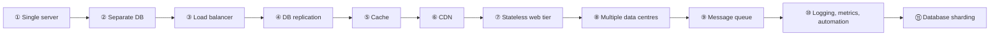
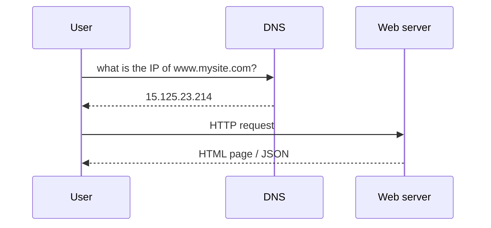
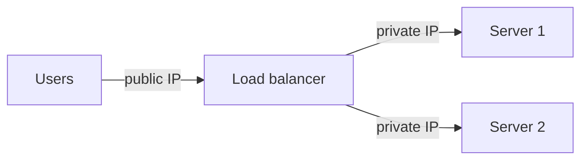
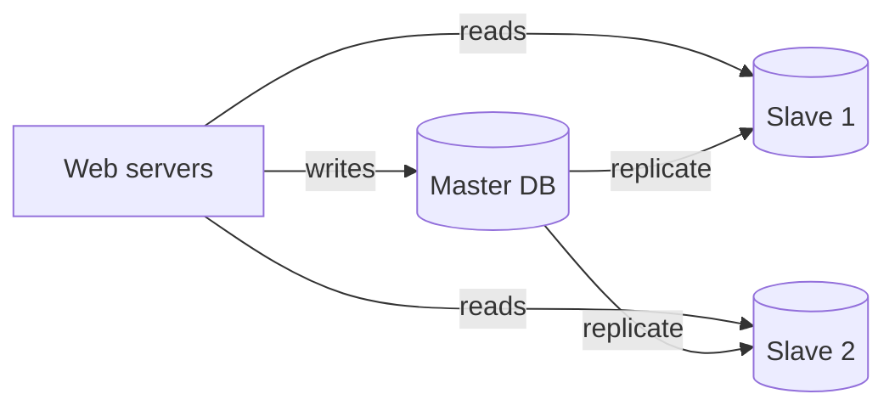
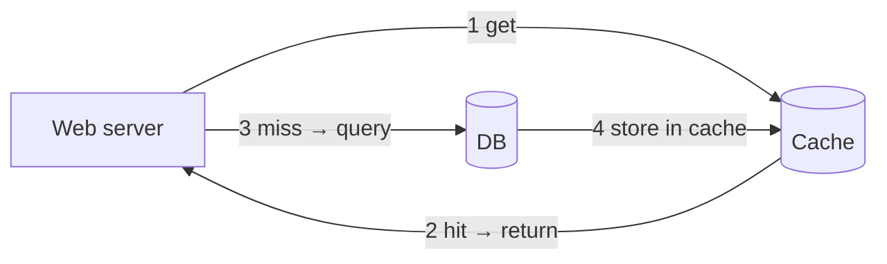
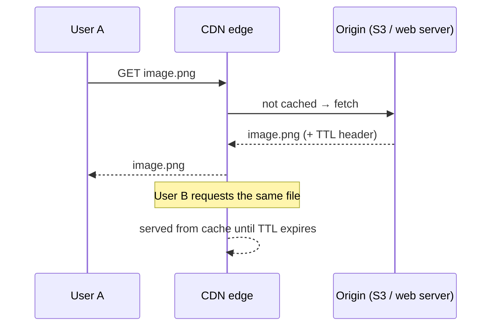
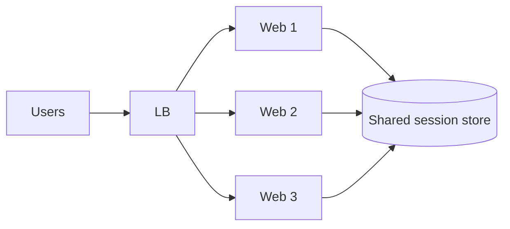
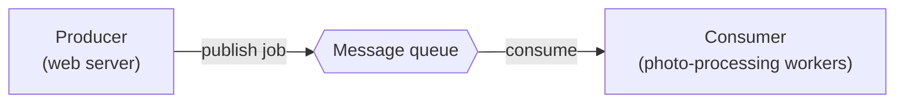
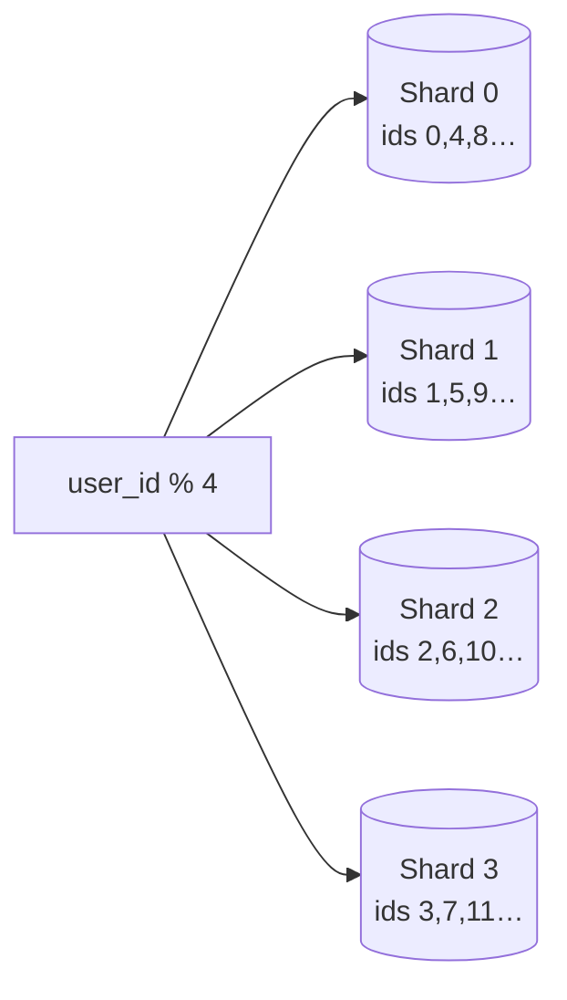

# Chapter 1 — Scale From Zero to Millions of Users

> **In one line:** Start with a single server, then add one building block at a time (load balancer, replicas, cache, CDN, stateless tier, data centres, queues, sharding) as users grow from 1 to 10 million+.
>
> This is the **foundation chapter**. Every later chapter reuses these building blocks.

*The animation shows the final architecture. The rest of this chapter builds it step by step.*

---

## The journey at a glance

---

## Step 1 — A single server
Everything (web app, database, cache) runs on **one machine**.

Traffic comes from **web browsers** (HTML) and **mobile apps** (JSON over HTTP APIs).

❌ One machine can't handle much load, and if it dies, everything is down.

---

## Step 2 — Separate the database
Put web/mobile traffic on **web servers** and data on **database servers**, so each tier can scale independently.

### Which database?
| | Relational (SQL) | Non-relational (NoSQL) |
|---|---|---|
| Examples | MySQL, PostgreSQL, Oracle | Cassandra, DynamoDB, MongoDB, Redis |
| Data | Tables + rows, **joins** | Key-value, document, column, graph |
| Choose when | Default choice. Well understood for 40+ years. | **Super-low latency**, unstructured data, only (de)serialisation needed, **massive** data volume |

---

## Step 3 — Vertical vs horizontal scaling
| | Vertical ("scale up") | Horizontal ("scale out") |
|---|---|---|
| How | Bigger machine: more CPU and RAM | **More machines** |
| Pros | Simple | No hard limit, redundancy |
| Cons | Hard ceiling, **single point of failure**, expensive | More complex |

## Step 3b — Load balancer

- Users connect to the **LB's public IP**. Servers are reachable only through **private IPs**, which improves security.
- If server 1 dies, traffic goes to server 2. If traffic grows, add server 3.

---

## Step 4 — Database replication (master/slave)

- **Master** handles writes. **Slaves** hold copies and serve reads. Most apps read far more than they write.
- **Benefits:** better performance (parallel reads), **reliability** (data survives a disaster), **availability**.
- **If a slave dies:** reads go to another slave or temporarily to the master.
- **If the master dies:** **promote** a slave to be the new master (and recover any missing data).

---

## Step 5 — Cache
A cache is **fast memory storage** for frequently read or expensive results.

This is the **read-through** strategy.

### Things to think about when caching
| Topic | Guidance |
|---|---|
| **When to use** | Data that is read often and modified rarely |
| **Expiration (TTL)** | Not too short (DB gets hammered), not too long (stale data) |
| **Consistency** | DB and cache can drift. Hard across regions. |
| **Failure** | One cache server is a **SPOF**. Use multiple, and over-provision memory. |
| **Eviction** | When full: **LRU** (most common), LFU, FIFO |

---

## Step 6 — CDN (Content Delivery Network)
Geographically distributed servers that serve **static content** (images, videos, CSS, JS) from **close to the user**.

**Considerations:** cost (don't cache rarely used files), sensible TTLs, a **fallback** to the origin if the CDN fails, and invalidation via the vendor API or **versioned URLs** (`image.png?v=2`).

---

## Step 7 — Stateless web tier ⭐
**Stateful** servers remember a user's session, so that user must always hit **the same** server ("sticky sessions"). That makes adding or removing servers hard.

**Stateless:** move session data **out** of the web servers into a shared store (Redis, NoSQL). Any server can handle any request, so **autoscaling** becomes easy.

---

## Step 8 — Multiple data centres
Users are routed to the nearest DC with **GeoDNS** (for example 70% US-East, 30% US-West). If one DC goes down, all traffic goes to the healthy one.

**Challenges:** traffic redirection, **data synchronisation** across DCs (replicate data to every region), and **testing and deployment** consistency across locations.

---

## Step 9 — Message queue
A durable buffer that lets components communicate **asynchronously**.

Producers and consumers **scale independently**. If the queue grows, add workers. If the consumer is down, jobs wait safely.

## Step 10 — Logging, metrics, automation
- **Logging:** aggregate error logs centrally.
- **Metrics:** host level (CPU, memory), aggregated (DB tier performance), and **business** (DAU, retention, revenue).
- **Automation:** CI/CD, automated builds and tests.

---

## Step 11 — Database scaling: sharding ⭐
Vertical DB scaling hits a ceiling. **Sharding** splits one big database into smaller **shards**, each holding a part of the data with the same schema.

The **sharding key** (partition key) decides which shard holds a row. Choose one that spreads data **evenly**.

### Sharding problems
| Problem | Meaning | Fix |
|---|---|---|
| **Resharding** | A shard fills up, or uneven data causes **shard exhaustion** | **Consistent hashing** (Ch 5) |
| **Celebrity / hotspot** | Justin Bieber's data overloads one shard | Give hot keys **their own shard**, or split further |
| **Joins** | Cross-shard joins are hard | **Denormalise** so queries hit one table |

---

## 🧠 Summary: how to scale to millions
- Keep the web tier **stateless**.
- Build **redundancy at every tier**.
- **Cache** as much as you can.
- Support **multiple data centres**.
- Host static assets on a **CDN**.
- Scale the data tier with **sharding**.
- Split tiers into individual services.
- **Monitor** the system and use **automation**.

## ✅ Self-check

1. Why make the web tier stateless?

Any server can handle any request, so you can freely add or remove servers (autoscaling) without breaking user sessions.

2. What happens when the master DB fails?

A slave is promoted to become the new master. Missing data may need to be recovered with scripts.

3. What is the celebrity problem?

A very popular key overloads the single shard that holds it. Fix it by giving that key its own shard or splitting the data further.

---
⬅️ — | [Next: Chapter 2 · Back-of-the-Envelope Estimation ➡️](02-Back-Of-The-Envelope-Estimation.md)
