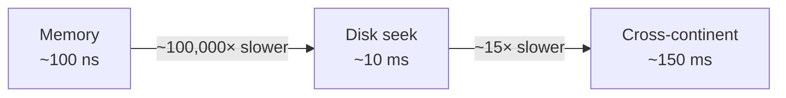
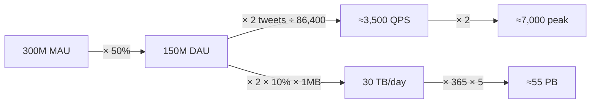

# Chapter 2 — Back-of-the-Envelope Estimation

> **In one line:** Quick, rough math (QPS, storage, servers) that tells you whether a design will work, *before* you build it.
>
> The goal is the right **order of magnitude**, not the exact number.



*Watch assumptions turn into daily users, then QPS, peak QPS and storage.*

---

## 1. Power of two (data volume units)

| Power | Approx. value | Name | Short |
|---|---|---|---|
| 2¹⁰ | 1 thousand | Kilobyte | 1 KB |
| 2²⁰ | 1 million | Megabyte | 1 MB |
| 2³⁰ | 1 billion | Gigabyte | 1 GB |
| 2⁴⁰ | 1 trillion | Terabyte | 1 TB |
| 2⁵⁰ | 1 quadrillion | Petabyte | 1 PB |

Reminders: **1 byte = 8 bits**. An ASCII character = 1 byte.

---

## 2. Latency numbers every programmer should know ⏱️

(Rounded, approximate, originally from Jeff Dean. Hardware has improved since, but the **ratios** still hold.)

| Operation | Time | Feels like… |
|---|---|---|
| L1 cache reference | ~0.5 ns | ⚡ instant |
| Branch mispredict | ~5 ns | |
| L2 cache reference | ~7 ns | |
| Mutex lock/unlock | ~100 ns | |
| **Main memory reference** | ~100 ns | |
| Compress 1 KB with Zippy | ~10 µs | |
| Send 2 KB over 1 Gbps network | ~20 µs | |
| **Read 1 MB sequentially from memory** | ~250 µs | |
| Round trip within the same data centre | ~500 µs | |
| **Disk seek** | ~10 ms | 🐢 |
| Read 1 MB sequentially from network | ~10 ms | |
| **Read 1 MB sequentially from disk** | ~30 ms | |
| **Send packet CA → Netherlands → CA** | ~150 ms | 🐌 |



### What to take away
- **Memory is fast, disk is slow.** Avoid disk seeks when you can.
- **Compression is cheap.** Compress before sending over the network.
- **Inter-region round trips are expensive.** Data centres in different regions take time to sync.

---

## 3. Availability numbers (the "nines")

| Availability | Downtime per year | Per day |
|---|---|---|
| 99% | 3.65 days | 14.4 min |
| 99.9% | 8.77 hours | 1.44 min |
| 99.99% | 52.6 min | 8.6 s |
| 99.999% | 5.26 min | 864 ms |
| 99.9999% | 31.5 s | 86 ms |

An **SLA** (Service Level Agreement) is the uptime a provider promises. Cloud providers typically promise 99.9% or more.

---

## 4. Worked example: estimate Twitter QPS and storage

**Assumptions**
- 300 million monthly active users. **50%** use it daily.
- Each user posts **2 tweets/day** on average.
- **10%** of tweets contain media.
- Data is stored for **5 years**.

**QPS**
```
DAU       = 300M × 50%            = 150M
Tweet QPS = 150M × 2 / 24h / 3600s ≈ 3,500
Peak QPS  = 2 × QPS               ≈ 7,000
```

**Media storage**
```
Average tweet: id 64 B, text 140 B, media 1 MB
Media per day = 150M × 2 × 10% × 1 MB = 30 TB/day
5-year storage = 30 TB × 365 × 5      ≈ 55 PB
```



---

## 5. Tips for estimating in interviews ✍️
| Tip | Example |
|---|---|
| **Round and approximate** | 99,987 / 9.1 becomes **100,000 / 10 = 10,000** |
| **Write down your assumptions** | So you (and the interviewer) can refer back |
| **Label your units** | "5" means nothing. Write **5 MB**. |
| **Know the common estimates** | QPS, peak QPS, storage, cache size, number of servers |

**Handy shortcut:** a day has **86,400 seconds, call it ~100,000 (10⁵)**. So `X per day ÷ 10⁵ ≈ X per second`.

### Quick formulas
```
QPS          = DAU × actions per user per day / 86,400
Peak QPS     = QPS × (2 to 5)
Storage/day  = writes per day × size per write
Cache memory = ~20% of daily read data (80/20 rule)
Servers      = Peak QPS / QPS one server can handle
```

---

## 🧠 Cheat sheet
- KB → MB → GB → TB → PB (each step is ×1,000, or 2¹⁰).
- Memory ≈ 100 ns. Disk seek ≈ 10 ms. Cross-continent ≈ 150 ms.
- 99.99% ≈ 52 min of downtime per year.
- 1 day ≈ 10⁵ seconds.
- **Round aggressively, state assumptions, label units.**

## ✅ Self-check
<details><summary>1. A service has 10M DAU, each making 10 requests a day. What is the average QPS?</summary>
10⁸ / 10⁵ ≈ 1,000 QPS (peak ≈ 2,000–5,000).
</details>
<details><summary>2. Why compress data before sending it over the network?</summary>
Compression is very cheap in CPU time (microseconds) compared with network transfer time (milliseconds).
</details>
<details><summary>3. How much downtime per year does "three nines" allow?</summary>
About 8.8 hours.
</details>

---
[⬅️ Chapter 1 · Scaling](01-Scale-From-Zero-To-Millions.md) | [Next: Chapter 3 · Interview Framework ➡️](03-System-Design-Interview-Framework.md)
