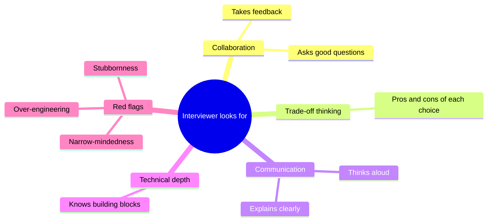
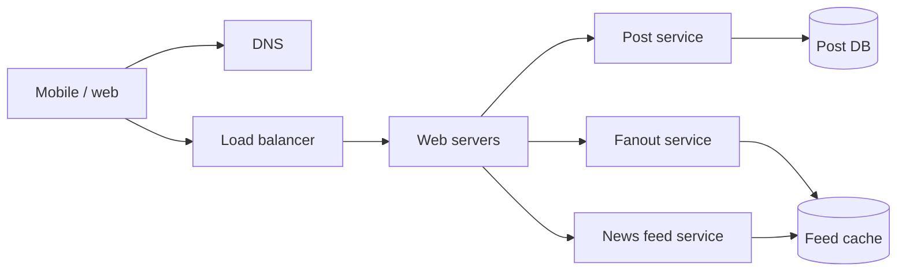

# Chapter 3 — A Framework for System Design Interviews

> **In one line:** A 4-step recipe for any "design X" interview: **understand → high-level design → deep dive → wrap up.**
>
> The interview simulates two co-workers solving an ambiguous problem together. There's no single right answer. The **process** is what's judged.

---

## What interviewers are really evaluating

---

## The 4 steps (for a 45-minute interview)

```mermaid
gantt
    title Typical 45-minute system design interview
    dateFormat mm
    axisFormat %M min
    section Steps
    ① Understand the problem & scope   :a1, 00, 7m
    ② High-level design & buy-in       :a2, after a1, 13m
    ③ Design deep dive                 :a3, after a2, 20m
    ④ Wrap up                          :a4, after a3, 5m
```

### Step 1 — Understand the problem and establish scope (3–10 min)
> 🚩 **Don't jump into a solution.** Answering quickly without thinking is a red flag.

Ask questions like:
- What **specific features** are we building?
- How many **users**? DAU? Growth expectation in 3 months, 6 months, a year?
- What is the company's **tech stack**? Which existing services can we use?
- Mobile, web, or both?

**Example: "Design a news feed"**
| Question | Agreed answer |
|---|---|
| Mobile or web? | Both |
| Key features? | Publish a post, see friends' posts |
| Feed order? | Reverse chronological (keep it simple) |
| Friends per user? | Up to 5,000 |
| Traffic? | 10M DAU |
| Media? | Images and videos |

**If something is unclear, make an assumption and write it down.**

### Step 2 — Propose a high-level design and get buy-in (10–15 min)
- Draw **box diagrams**: clients, APIs, web servers, data stores, cache, CDN, queue…
- Do **back-of-the-envelope** math to check that the design fits the scale.
- Walk through a few **concrete use cases**. This often surfaces edge cases.
- Treat the interviewer as a **teammate**: "Does this approach make sense to you?"
- Include API endpoints or a DB schema? It depends on the problem, so ask.

### Step 3 — Design deep dive (10–25 min)
By now you and the interviewer agree on the goals and the blueprint. Now:
- **Prioritise** the components that matter most for this problem. The interviewer may point you to them.
  - URL shortener → the **hash function**.
  - Chat system → **latency** and **online/offline status**.
- **Manage your time.** Don't spend 10 minutes on an unimportant detail such as the EdgeRank algorithm.

### Step 4 — Wrap up (3–5 min)
- **Bottlenecks** and potential improvements. There's always something to improve.
- **Recap** your design, which is especially useful if you offered several options.
- **Error cases:** server failure, network loss.
- **Operations:** monitoring, metrics, logging, rollout.
- **Next scale curve:** what changes at 10× users?

---

## ✅ Dos and ❌ Don'ts

| ✅ Do | ❌ Don't |
|---|---|
| Ask for clarification. Don't assume your guess is right. | Come unprepared for typical questions |
| Understand the requirements | Jump into a solution without clarifying |
| Think out loud | Go into deep detail on one component at the start |
| Suggest multiple approaches | Get stuck and stay silent. Ask for hints! |
| Design the most critical components first | Think you're done when you've drawn boxes |
| Bounce ideas off the interviewer | Never "declare victory" early |
| **Never give up** | |

---

## 🧠 Cheat sheet
1. **Clarify**: features, users, scale, constraints. Write down assumptions.
2. **Blueprint**: boxes, APIs, estimates. Get **buy-in**.
3. **Deep dive**: the 2–3 most important or hardest parts.
4. **Wrap up**: bottlenecks, failures, monitoring, scaling further.

## ✅ Self-check

1. What should you do in the first 5 minutes?

Ask clarifying questions and agree on scope and assumptions. Don't start designing yet.

2. How do you decide what to deep dive into?

Focus on the components most critical or most challenging for this specific system, guided by the interviewer's signals.

---
[⬅️ Chapter 2 · Estimation](02-Back-Of-The-Envelope-Estimation.md) | [Next: Chapter 4 · Rate Limiter ➡️](04-Design-A-Rate-Limiter.md)
