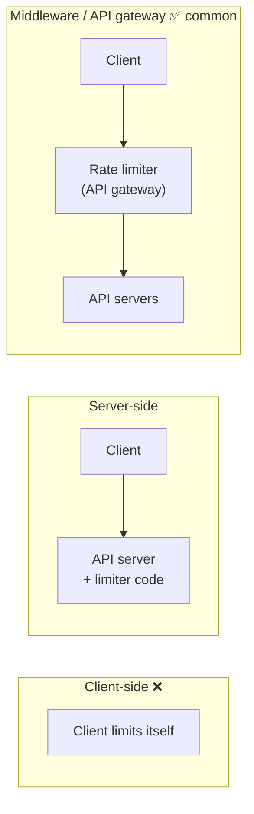
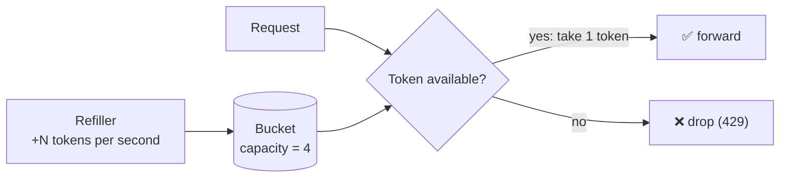
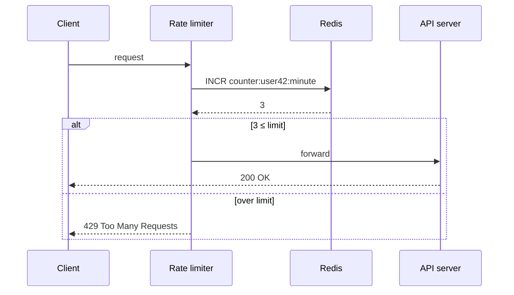
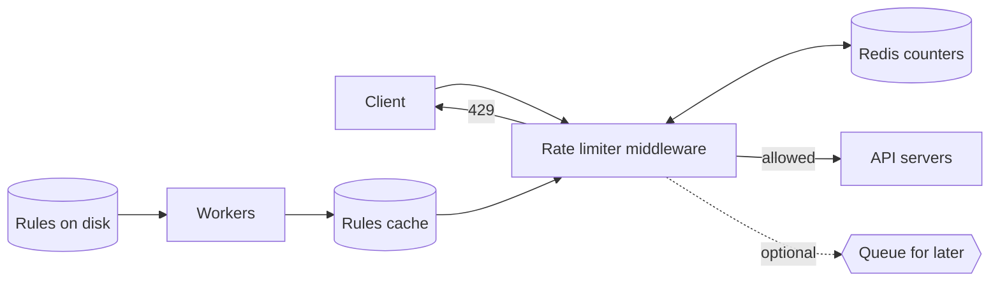

# Chapter 4 — Design a Rate Limiter

> **In one line:** Cap how many requests a client can make in a time window (for example **5 posts per second**). Extra requests are blocked with **HTTP 429**.
>
> **Why:** prevent DoS and abuse, **reduce cost** (especially for paid third-party APIs), and stop any one user from overloading servers.



*Requests pass through the limiter. A Redis counter decides whether each one is forwarded or rejected with 429.*

---

## 1. Requirements
- Accurately limit excessive requests. **Low latency**, since it sits on every request. Little memory.
- **Distributed:** shared across many servers.
- **Clear exceptions** (HTTP 429) so users know they were throttled.
- **Fault tolerant:** if the limiter fails, the whole system shouldn't go down.

---

## 2. Where to put it?

- **Client-side** is unreliable, because clients can be forged.
- **API gateway** (a managed service that also handles SSL termination, auth, IP allowlists) is common with microservices.
- Choose based on your tech stack, team skills, and whether you need full control of the algorithm.

---

## 3. The five algorithms ⭐⭐

### 3.1 Token bucket 🪣 (used by Amazon and Stripe)

- Parameters: **bucket size** and **refill rate**.
- ✅ Simple, memory-efficient, **allows short bursts**.
- ⚠️ Tuning the two parameters can be tricky.

### 3.2 Leaking bucket 🚰 (used by Shopify)
Requests enter a **FIFO queue** and are processed at a **fixed rate**. If the queue is full, they are dropped.
- ✅ Smooth, **stable outflow rate**.
- ⚠️ A burst fills the queue with old requests, and recent ones get dropped.

### 3.3 Fixed window counter
Split time into fixed windows (for example each minute) with a counter. Reject requests once the counter reaches the limit.
- ✅ Simple, memory-efficient.
- ❌ **Edge spike:** 5 requests at 0:59 plus 5 at 1:01 = **10 requests in 2 seconds**, double the intended limit.

```
limit 5/min   |----- minute 1 -----|----- minute 2 -----|
                              ●●●●●|●●●●●
                         10 requests in ~2 seconds 😱
```

### 3.4 Sliding window log
Store the **timestamp** of every request (in a Redis sorted set). On each new request, remove timestamps older than the window, count what's left, and allow if the count is under the limit.
- ✅ **Very accurate.**
- ❌ **Memory-heavy**: it stores timestamps even of rejected requests.

### 3.5 Sliding window counter (hybrid) ✅ popular
```
requests in rolling window ≈ current_window_count
                           + previous_window_count × overlap%
Example: limit 7/min, prev minute = 5, current = 3, we're 30% into current minute
→ 3 + 5 × 70% = 6.5 → round down to 6 → allowed (6 < 7)
```
- ✅ Smooths spikes and is memory-efficient.
- ⚠️ An approximation (it assumes the previous window was evenly distributed). Cloudflare found only about 0.003% of requests wrongly handled.

| Algorithm | Burst friendly | Memory | Accuracy |
|---|---|---|---|
| Token bucket | ✅ | Low | Good |
| Leaking bucket | ❌ (smooths) | Low | Good |
| Fixed window | ⚠️ edge spikes | Lowest | Weak at edges |
| Sliding log | ❌ | **High** | **Best** |
| Sliding counter | ✅ | Low | Very good |

---

## 4. High-level architecture
Counters must be **fast**, so keep them **in memory**, not on disk. **Redis** is ideal:
- `INCR key`: increment the counter.
- `EXPIRE key seconds`: auto-delete the counter when the window ends.



---

## 5. Deep dive

### 5.1 Rate-limiting rules
Rules are written in config files (for example YAML, as in Lyft's open-source limiter) and cached by workers:
```yaml
domain: messaging
descriptors:
  - key: message_type
    value: marketing
    rate_limit:
      unit: day
      requests_per_unit: 5
```

### 5.2 What the client sees: HTTP headers
| Header | Meaning |
|---|---|
| `X-Ratelimit-Remaining` | Requests remaining in this window |
| `X-Ratelimit-Limit` | Requests allowed per window |
| `X-Ratelimit-Retry-After` | Seconds to wait before retrying |

Rejected requests get **429** and can be **dropped** or **queued** to process later (for example, orders under heavy load).

### 5.3 Detailed design


### 5.4 Distributed challenges ⭐
**Race condition:** two servers both read `counter = 3`, both write 4, and one request gets through uncounted.
Fix: **Lua scripts** in Redis (atomic read-modify-write) or **sorted sets**. Avoid locks, which are slow.

**Synchronisation:** with many limiter instances, a user's requests may hit different ones. Don't rely on sticky sessions. Use a **centralised Redis** that all limiters share.

### 5.5 Performance
- Deploy limiters at the **edge** in many regions (multi-DC) for low latency.
- Synchronise counters with an **eventual consistency** model.

### 5.6 Monitoring
Check that the algorithm and rules are effective: too strict means valid requests get dropped; too loose fails to protect against sudden bursts (flash sales). Switch algorithms if needed, for example to a token bucket for bursts.

---

## 6. Beyond the basics
- **Hard vs soft limits:** a hard limit can never be exceeded. A soft limit can be briefly exceeded.
- **Other layers:** rate limit at OSI **layer 3** by IP using **iptables**.
- **Client best practices:** cache responses, respect limits, catch 429s gracefully, retry with **backoff**.

---

## 🧠 Cheat sheet
- Usually lives at the **API gateway / middleware**.
- Algorithms: **token bucket** (bursts OK), leaking bucket (smooth), fixed window (edge spike), sliding log (accurate, memory-heavy), **sliding counter** (best balance).
- **Redis INCR + EXPIRE**. Use **Lua scripts** to avoid races.
- Return **429** plus the `X-Ratelimit-*` headers.

## ✅ Self-check
<details><summary>1. What is the weakness of the fixed window counter?</summary>
Bursts at the edges of two windows can let through up to twice the limit within a short span.
</details>
<details><summary>2. How do you prevent race conditions on the counter?</summary>
Use an atomic operation: a Redis Lua script or a sorted-set based approach, rather than separate read and write steps.
</details>
<details><summary>3. Why keep counters in Redis rather than a database?</summary>
Every request needs a counter check, so it must be in-memory fast. Redis also supports TTL-based expiry.
</details>

---
[⬅️ Chapter 3 · Framework](03-System-Design-Interview-Framework.md) | [Next: Chapter 5 · Consistent Hashing ➡️](05-Design-Consistent-Hashing.md)
