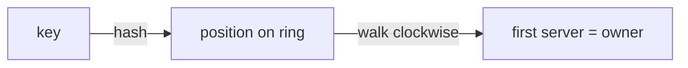
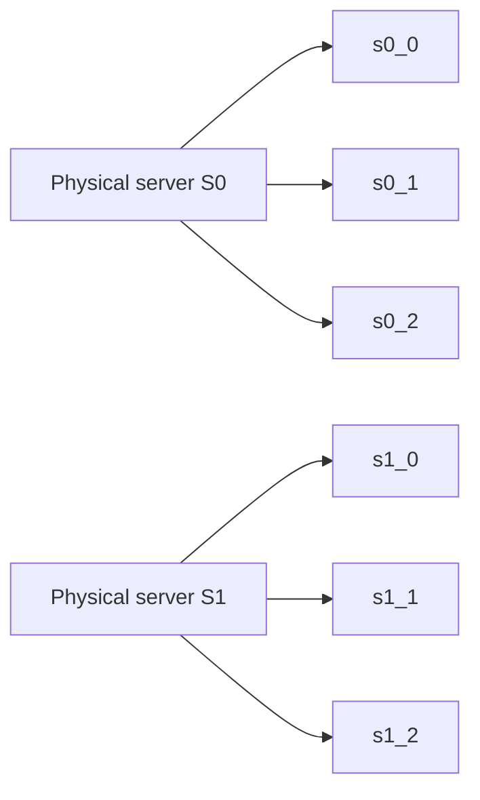

# Chapter 5 — Design Consistent Hashing

> **In one line:** A way to spread keys across servers so that **adding or removing a server moves only a small fraction of keys**, instead of reshuffling almost everything.
>
> **Used by:** DynamoDB, Cassandra, Discord, Akamai CDN, the Maglev load balancer.



*Keys walk clockwise to the next server. When Server 4 joins, only one key moves.*

---

## 1. The rehashing problem

The simple approach is `serverIndex = hash(key) % N`.

| key | hash | % 4 servers | % 3 servers (one died) |
|---|---|---|---|
| key0 | 18358617 | **1** | **0** |
| key1 | 26143584 | **0** | **0** |
| key2 | 18131146 | **2** | **1** |
| key3 | 35863496 | **0** | **2** |

When **N changes**, almost **every key moves**. For a cache cluster that means a storm of **cache misses** hitting the database. 😱

---

## 2. The idea: put everything on a ring

1. Take a hash function's output space (for example SHA-1: 0 … 2¹⁶⁰−1) and **bend it into a circle**.
2. **Hash the servers** (by IP or name) onto the ring.
3. **Hash each key** onto the ring.
4. A key belongs to the **first server found clockwise** from it.



### Adding a server
New Server 4 is placed between S1 and S2. Only the keys **between S1 and S4** move to S4. Everyone else stays.

### Removing a server
If S1 is removed, only S1's keys move to the **next** server clockwise.

---

## 3. Two problems with the basic version

| Problem | Why |
|---|---|
| **Uneven partition sizes** | Servers land randomly, so one may own a huge arc and another a tiny one |
| **Uneven key distribution** | Most keys may end up on one server |

## 4. The fix: virtual nodes ⭐

Each physical server appears on the ring **many times** as **virtual nodes** (for example S0_0, S0_1, S0_2 …).


```
Ring (clockwise):  s0_0 → s1_0 → s0_1 → s1_1 → s0_2 → s1_2 → back to s0_0
Each server now owns many small, interleaved arcs → balanced.
```
- More virtual nodes give a **more balanced** distribution. With 100–200 virtual nodes, the standard deviation of load is roughly 5–10% of the mean.
- Trade-off: more memory for the virtual-node metadata.
- Bonus: give a **more powerful server more virtual nodes**, so it takes a bigger share.

---

## 5. Finding the affected keys
- **Server added:** the keys moving to it are those between the new node and the **previous** node (anti-clockwise).
- **Server removed:** its keys move to the **next** node clockwise.

---

## 6. Benefits recap
- **Minimal key movement** when servers change, about `k/N` keys on average (k = keys, N = servers).
- **Easy horizontal scaling**, with data spread evenly thanks to virtual nodes.
- **Mitigates hotspots.** Celebrity keys are less likely to overload one shard.

---

## 🧠 Cheat sheet
- `hash % N` → nearly **all keys move** when N changes.
- Ring: servers and keys are hashed onto a circle. A key goes to the **next server clockwise**.
- Adding or removing a server affects only **neighbouring** keys.
- **Virtual nodes** fix imbalance and let you weight stronger servers.

## ✅ Self-check
<details><summary>1. With 4 servers and hash % N, roughly how many keys move when one server fails?</summary>
Most of them (about 75%), because nearly every key's modulus changes.
</details>
<details><summary>2. What problem do virtual nodes solve?</summary>
Uneven arc sizes and key distribution. Many small interleaved arcs per server balance the load.
</details>
<details><summary>3. When a node is added, which keys move?</summary>
Only keys between the new node and its anti-clockwise predecessor.
</details>

---
[⬅️ Chapter 4 · Rate Limiter](04-Design-A-Rate-Limiter.md) | [Next: Chapter 6 · Key-Value Store ➡️](06-Design-A-Key-Value-Store.md)
