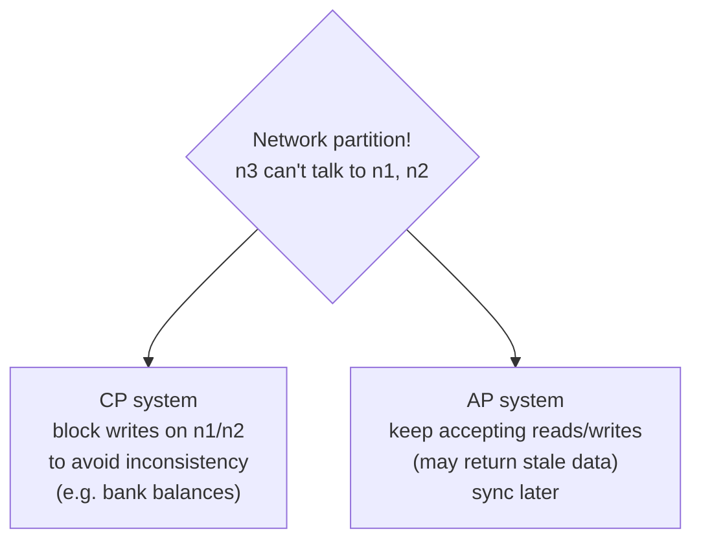
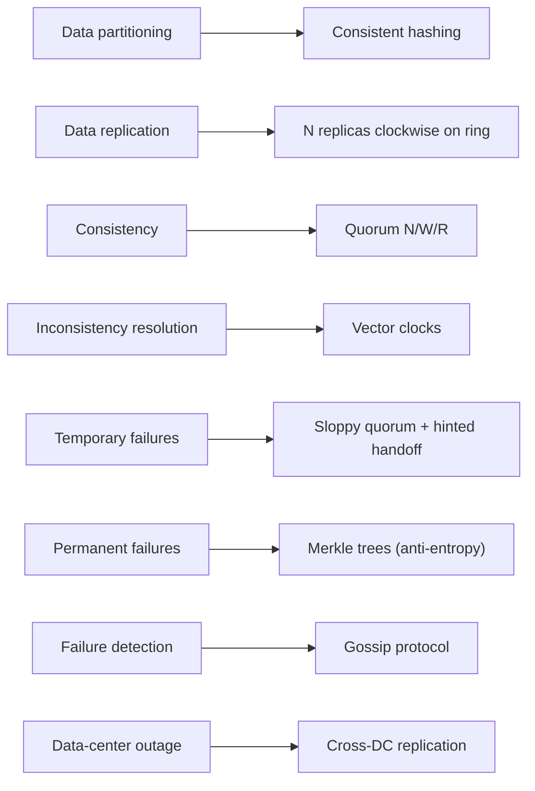
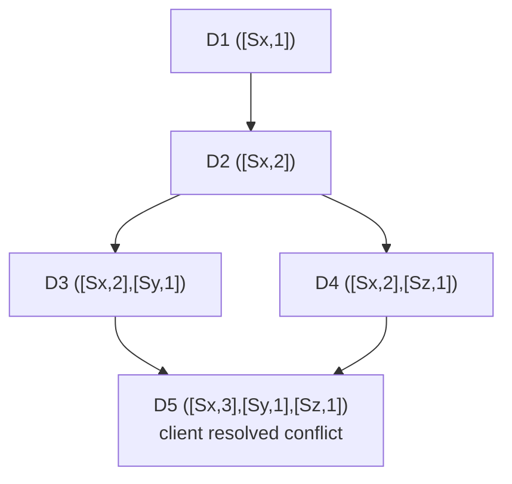
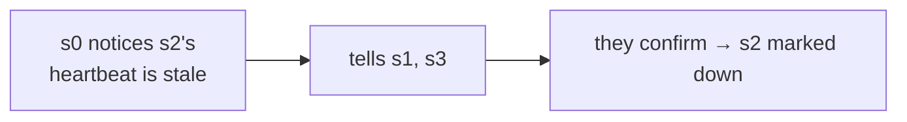
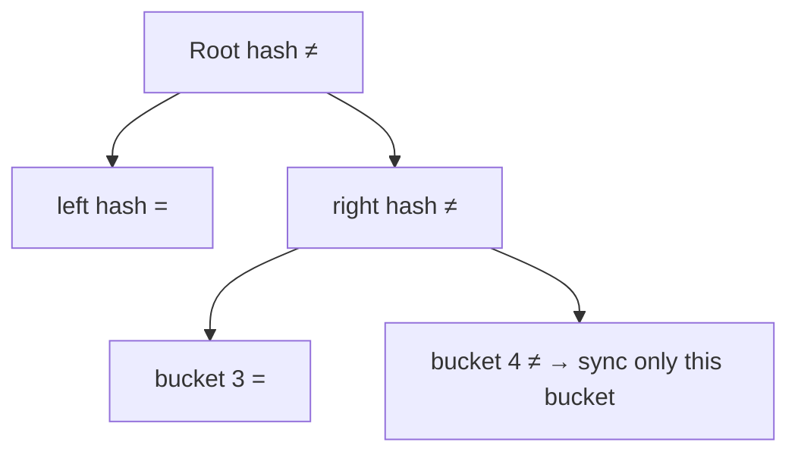
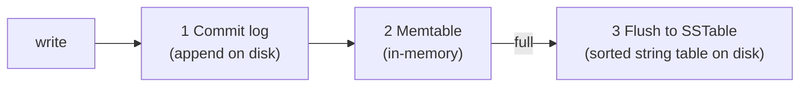
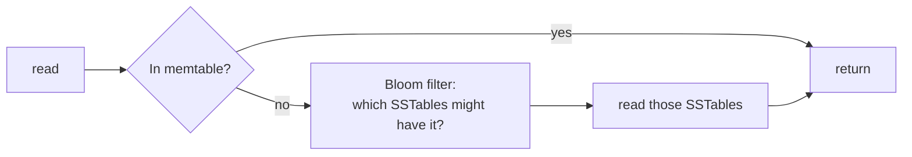

# Chapter 6 — Design a Key-Value Store

> **In one line:** Build a distributed `put(key, value)` / `get(key)` database (like **DynamoDB, Cassandra, Riak**) that is always available, scales out, and tolerates failures.

*A write goes to N=3 replicas and succeeds after W=2 acks. A read asks R=2 replicas. Because W + R > N, at least one is up to date.*

---

## 1. Requirements
- Small key-value pairs (< 10 KB). Store **big data**.
- **High availability:** respond quickly even during failures.
- **High scalability** and **automatic scaling**.
- **Tunable consistency.** Low latency.

---

## 2. Single server first
A hash table in memory is fast but limited by RAM. Tricks: **compress** data, keep frequently used data in memory and the rest on disk. Eventually we must **distribute** it.

---

## 3. CAP theorem ⭐⭐
In a distributed system you can't have all three:

| Letter | Meaning |
|---|---|
| **C**onsistency | Every client sees the **same data** at the same time, whichever node it asks |
| **A**vailability | Every request gets a response, even if some nodes are down |
| **P**artition tolerance | The system keeps working when the network **splits** nodes apart |

**Network partitions will happen**, so in practice you choose **CP** or **AP**:

This chapter designs an **AP** store with **eventual consistency**, like Dynamo and Cassandra.

---

## 4. The core components (each solves one problem)

### 4.1 Data partition: consistent hashing (Ch 5)
Keys are spread across servers on a hash ring with virtual nodes. This gives **automatic scaling** and **heterogeneity** (stronger servers get more virtual nodes).

### 4.2 Data replication
Store each key on the **first N distinct physical servers** clockwise on the ring (for example N=3). Put replicas in **different data centres** for safety.

### 4.3 Consistency: quorum ⭐
- **N** = number of replicas
- **W** = acks needed for a write to succeed
- **R** = responses needed for a read

| Setting | Effect |
|---|---|
| `R=1, W=N` | Fast reads |
| `W=1, R=N` | Fast writes |
| **`W + R > N`** | **Strong consistency**: the read and write sets overlap, so at least one node has the latest data |
| `W + R ≤ N` | Not guaranteed strong |

Typical choice: **N=3, W=2, R=2**.

### Consistency models
- **Strong:** reads always see the latest write.
- **Weak:** reads might not see the latest.
- **Eventual** (a form of weak): given enough time, all replicas converge. Used by Dynamo and Cassandra.

---

## 5. Inconsistency resolution: versioning and vector clocks ⭐
In an AP system, two replicas may accept **conflicting writes** (n1 writes "johnSanFrancisco", n2 writes "johnNewYork").

A **vector clock** is a list of `[server, version]` pairs attached to each value. It lets you tell whether one version is an **ancestor** of another (no conflict) or whether they are **siblings** (conflict).

- If every counter in X ≥ the matching counter in Y, then **X is newer**.
- If neither dominates, it's a **conflict**, and the **client** reconciles it on the next read.
- ⚠️ This adds complexity on the client, and the clocks can grow large (cap the length and drop the oldest entries).

---

## 6. Handling failures

### 6.1 Failure detection: gossip protocol
- Each node keeps a **membership list** with **heartbeat counters**.
- Nodes periodically increment their own heartbeat and send it to a few **random** nodes, which pass it on.
- If a node's heartbeat hasn't increased for a while, it's considered **down**. Several sources must agree, so one node's opinion isn't enough.

### 6.2 Temporary failures: sloppy quorum + hinted handoff
Instead of strictly using the first N nodes, use the **first N healthy** nodes. If s2 is down, s3 temporarily accepts its writes with a **hint**. When s2 recovers, s3 **hands the data back**.

### 6.3 Permanent failures: anti-entropy with Merkle trees ⭐
To sync replicas efficiently, compare **hash trees** instead of every key:
1. Split the key space into buckets.
2. Hash each bucket. Then hash pairs of hashes up to a **root**.
3. Compare roots. If they're equal, the replicas match. If not, walk down only the **mismatching branches**.

The data transferred is proportional to the **differences**, not the total size.

### 6.4 Data-centre outage
Replicate across **multiple data centres** so users can still reach data if one DC is completely offline.

---

## 7. System architecture
- Clients talk to the store through `get` / `put`.
- A **coordinator** node acts as a proxy between the client and the replicas.
- Nodes sit on a consistent-hashing ring. The system is **decentralised**: every node has the same responsibilities, so there is **no single point of failure**.

### Write path (Cassandra-style)

### Read path

A **Bloom filter** quickly says "definitely not here" or "maybe here", which saves disk reads.

---

## 🧠 Cheat sheet
| Goal / problem | Technique |
|---|---|
| Store big data | Consistent hashing to spread load |
| High-availability reads | Replication, multi-DC |
| Highly available writes | Versioning + **vector clocks** |
| Dataset partition | Consistent hashing |
| Incremental scalability | Consistent hashing |
| Heterogeneity | Virtual nodes |
| Tunable consistency | **Quorum (N, W, R)** |
| Temporary failures | **Sloppy quorum + hinted handoff** |
| Permanent failures | **Merkle trees** |
| DC outage | Cross-DC replication |
| Failure detection | **Gossip** |

## ✅ Self-check

1. Why does W + R > N give strong consistency?

The set of nodes written and the set read must overlap in at least one node, which has the latest value.

2. What is hinted handoff?

A healthy node temporarily stores writes meant for a down node and returns them when it recovers.

3. Why use Merkle trees?

To find and sync only the parts of the data that differ between replicas, minimising transfer.

---
[⬅️ Chapter 5 · Consistent Hashing](05-Design-Consistent-Hashing.md) | [Next: Chapter 7 · Unique ID Generator ➡️](07-Design-A-Unique-ID-Generator.md)
