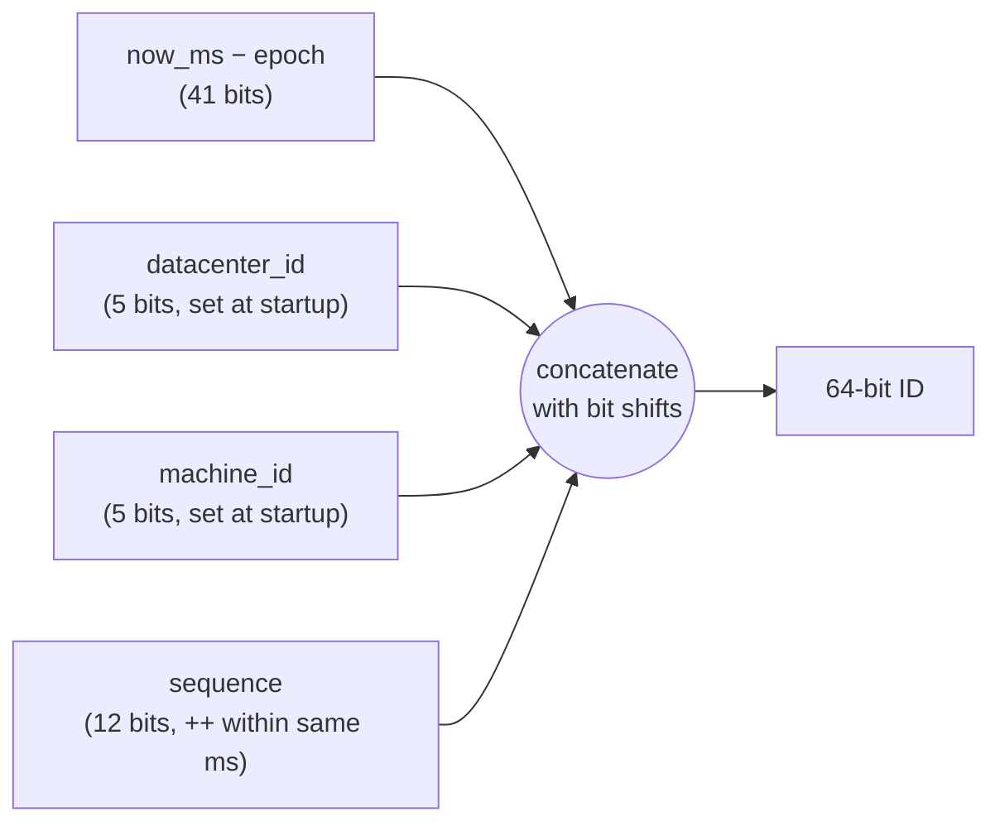

# Chapter 7 — Design a Unique ID Generator in Distributed Systems

> **In one line:** Generate IDs that are **unique**, **numeric**, **64-bit**, **ordered by time**, at **10,000+ per second**, across many machines, with no single bottleneck.



*A Snowflake ID is assembled locally from timestamp + datacenter + machine + sequence bits.*

---

## 1. Why not just AUTO_INCREMENT?
A single database's `AUTO_INCREMENT` works on **one** server. Across many DB servers it can't guarantee uniqueness, and it's too slow at scale.

## 2. Requirements
- IDs must be **unique** and **numeric only**.
- They fit into **64 bits**.
- **Ordered by date** (a newer ID is larger than an older one).
- More than **10,000 IDs per second**.

---

## 3. Four options

### 3.1 Multi-master replication
Each DB server uses `AUTO_INCREMENT` with **step = k** (the number of servers). Server 1 gives 1, 3, 5… and server 2 gives 2, 4, 6…

❌ Hard to scale across DCs. IDs don't increase with time across servers. Adding or removing servers breaks the scheme.

### 3.2 UUID
A 128-bit random ID (`09c93e62-50b4-468d-bf8a-c07e1040bfb2`), generated independently with almost zero collision chance.

✅ Simple, no coordination, scales.
❌ **128 bits** (we need 64), **not time-ordered**, and not numeric.

### 3.3 Ticket server (used by Flickr)
One central DB with `AUTO_INCREMENT` hands out IDs to all web servers.

✅ Numeric, easy for small to medium scale.
❌ **Single point of failure**. Multiple ticket servers bring sync problems.

### 3.4 Twitter Snowflake ✅ (the winner)
"Divide and conquer": split the 64-bit ID into sections.

```
| 1 bit | 41 bits timestamp | 5 bits DC | 5 bits machine | 12 bits sequence |
|  0    | ms since epoch    | 0–31      | 0–31           | 0–4095 per ms    |
```

| Section | Bits | Purpose |
|---|---|---|
| Sign | 1 | Always 0 (reserved) |
| **Timestamp** | 41 | Milliseconds since a custom epoch (Twitter: Nov 4, 2010). 2⁴¹ ms ≈ **69 years** |
| Datacenter ID | 5 | 2⁵ = 32 data centres |
| Machine ID | 5 | 32 machines per DC |
| **Sequence** | 12 | Incremented for each ID within the same ms on that machine. Resets to 0 every ms. **4,096 IDs/ms per machine** |

---

## 4. Comparison

| | Multi-master | UUID | Ticket server | **Snowflake** |
|---|---|---|---|---|
| Unique | ✅ | ✅ | ✅ | ✅ |
| 64-bit numeric | ✅ | ❌ (128) | ✅ | ✅ |
| Time-ordered | ❌ | ❌ | ✅ | ✅ (roughly) |
| No SPOF | ⚠️ | ✅ | ❌ | ✅ |
| 10k+/s | ⚠️ | ✅ | ⚠️ | ✅ |

---

## 5. Deep dive: how the bits are produced

```text
id = (timestamp << 22) | (datacenter_id << 17) | (machine_id << 12) | sequence
```
**Reading the time back:** `timestamp = id >> 22`, then add the epoch to get a real date.

DC and machine IDs are chosen at **startup** and rarely change (changing them by accident can cause conflicts). Timestamp and sequence are generated **at runtime**.

---

## 6. Extra topics to mention
- **Clock synchronisation:** machines' clocks drift. Use **NTP**. Clock skew can break ordering across machines.
- **Tune section lengths:** for low-concurrency, long-lived apps, use fewer sequence bits and more timestamp bits.
- **High availability:** the generator is mission-critical, so run it on every machine and keep it simple.

---

## 🧠 Cheat sheet
- Options: multi-master, UUID, ticket server, **Snowflake**.
- Snowflake = **1 + 41 (time) + 5 (DC) + 5 (machine) + 12 (sequence)** bits.
- **Generated locally, no coordination**. Up to 4,096 IDs per ms per machine. Sortable by time.
- Watch out for **clock skew** (NTP).

## ✅ Self-check
<details><summary>1. Why isn't UUID suitable here?</summary>
It's 128 bits (not 64), not numeric-only, and not ordered by time.
</details>
<details><summary>2. How many IDs per second can one Snowflake machine produce?</summary>
4,096 per millisecond, which is about 4 million per second.
</details>
<details><summary>3. How long do 41 timestamp bits last?</summary>
2⁴¹ milliseconds, about 69 years from the custom epoch.
</details>

---
[⬅️ Chapter 6 · Key-Value Store](06-Design-A-Key-Value-Store.md) | [Next: Chapter 8 · URL Shortener ➡️](08-Design-A-URL-Shortener.md)
