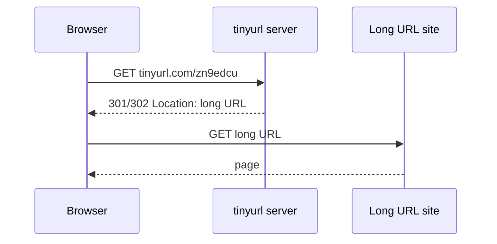
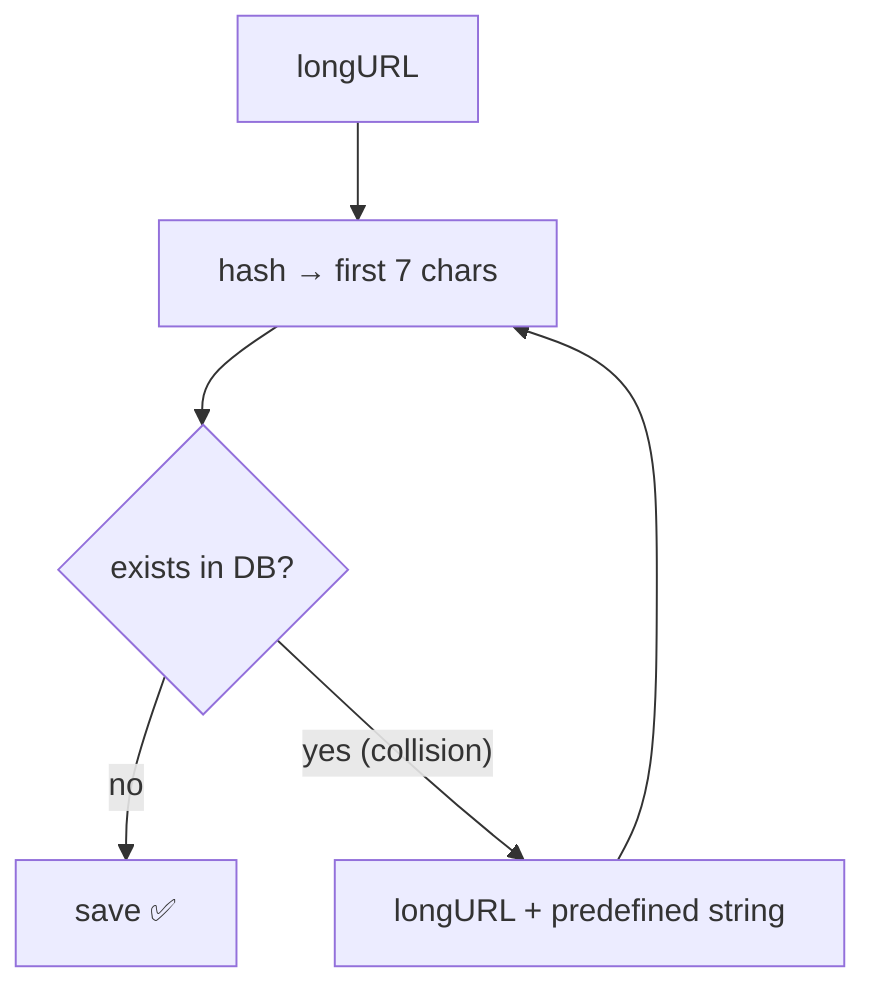
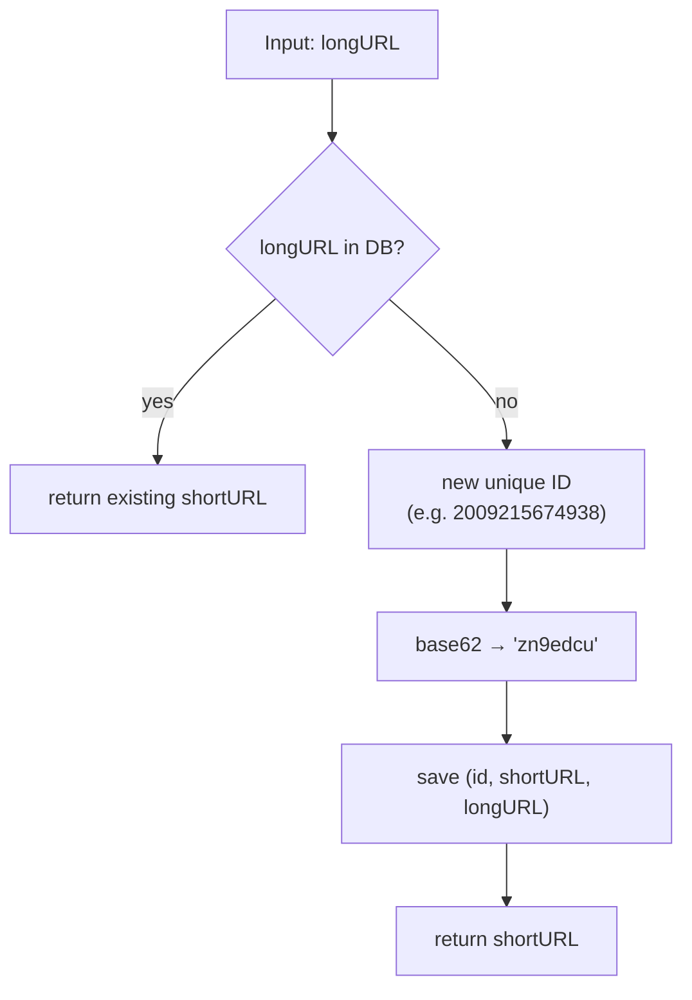
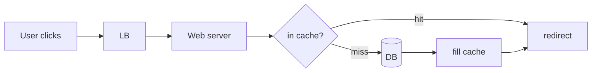

# Chapter 8 — Design a URL Shortener

> **In one line:** Turn `https://www.systeminterview.com/q=chatsystem&c=loggedin&v=v3&l=long` into `https://tinyurl.com/y7keocwj`, and redirect anyone who clicks it.



*Orange: creating a short URL. Indigo: clicking a short URL and being redirected.*

---

## 1. Requirements and estimation
- **Shorten:** long URL → short URL. **Redirect:** short URL → long URL.
- High availability, scalability, fault tolerance.
- Short URLs are as short as possible, using characters `[0-9a-zA-Z]`. They can't be deleted or updated (for simplicity).

```
100M URLs generated per day
Write QPS  = 100M / 86,400 ≈ 1,160
Read QPS   = 10 × write (10:1 ratio) ≈ 11,600
10 years   = 100M × 365 × 10 = 365 billion records
Storage    = 365B × 100 bytes ≈ 36.5 TB
```

---

## 2. API
```http
POST /api/v1/data/shorten   { "longUrl": "..." }   → shortURL
GET  /api/v1/{shortUrl}                           → 301/302 redirect to longURL
```

### 301 vs 302 redirect ⭐
| | **301 Moved Permanently** | **302 Found (temporary)** |
|---|---|---|
| Browser behaviour | **Caches** the redirect. Later clicks skip our server. | Every click comes **back to our server** |
| Server load | ✅ Lower | Higher |
| Analytics (click tracking) | ❌ Lost | ✅ Possible |



---

## 3. The core: a hash table
Store `shortURL → longURL`. In memory that would be too big, so use a **relational DB** table: `(id, shortURL, longURL)`.

### How long should the short code be?
With 62 possible characters, we need `62ⁿ ≥ 365 billion`:

| n | 62ⁿ |
|---|---|
| 6 | ~56.8 billion |
| **7** | **~3.5 trillion ✅** |

So the short code is **7 characters**.

---

## 4. Two ways to generate the code ⭐⭐

### 4.1 Hash + collision resolution
Take `CRC32 / MD5 / SHA-1(longURL)` and keep the **first 7 characters**. On a **collision**, append a predefined string and hash again until it's unique.


- Checking the DB on every write is expensive, so use a **Bloom filter** to test existence quickly.

### 4.2 Base-62 conversion ✅
Give every URL a **unique ID** (from the Ch 7 generator), then convert the ID to base 62.

```
Mapping: 0–9 → '0'–'9', 10–35 → 'a'–'z', 36–61 → 'A'–'Z'
Example: 11157₁₀ = 2×62² + 55×62 + 59 → [2, 55, 59] → "2TX"
```

| | Hash + collision | **Base 62** |
|---|---|---|
| Length | Fixed 7 | Grows with the ID |
| Needs ID generator | ❌ | ✅ |
| Collisions | Possible (must resolve) | ❌ Impossible (IDs are unique) |
| Next URL guessable? | ❌ | ⚠️ Yes (sequential), which is a security concern |

---

## 5. Detailed flows

### Shortening


### Redirecting (read-heavy, so cache it)


---

## 6. Wrap-up topics
- **Rate limiter** (Ch 4) against abusive bulk shortening.
- **Web tier** is stateless, so it scales easily. The **DB** scales with replication and sharding.
- **Analytics:** with 302 you can track clicks, sources and time.
- **Availability, consistency and reliability:** the core of any large system.

---

## 🧠 Cheat sheet
- Read:write ≈ 10:1, so **cache** the redirects.
- **7 characters** of base 62 gives 3.5 trillion codes.
- **Base 62 of a unique ID** (no collisions) vs **hash + collision check** (Bloom filter).
- **301** = cached and cheaper. **302** = analytics.

## ✅ Self-check
<details><summary>1. Why 7 characters?</summary>
62⁷ ≈ 3.5 trillion, which is more than the 365 billion URLs needed over 10 years.
</details>
<details><summary>2. When would you choose 302 over 301?</summary>
When you need click analytics, since every click must reach your server.
</details>
<details><summary>3. What is the downside of base-62 IDs?</summary>
They're sequential, so the next short URL is easy to guess.
</details>

---
[⬅️ Chapter 7 · Unique IDs](07-Design-A-Unique-ID-Generator.md) | [Next: Chapter 9 · Web Crawler ➡️](09-Design-A-Web-Crawler.md)
