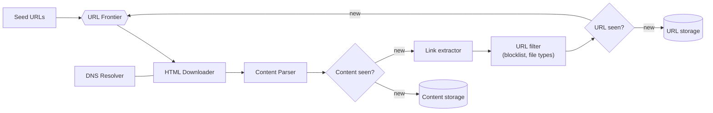
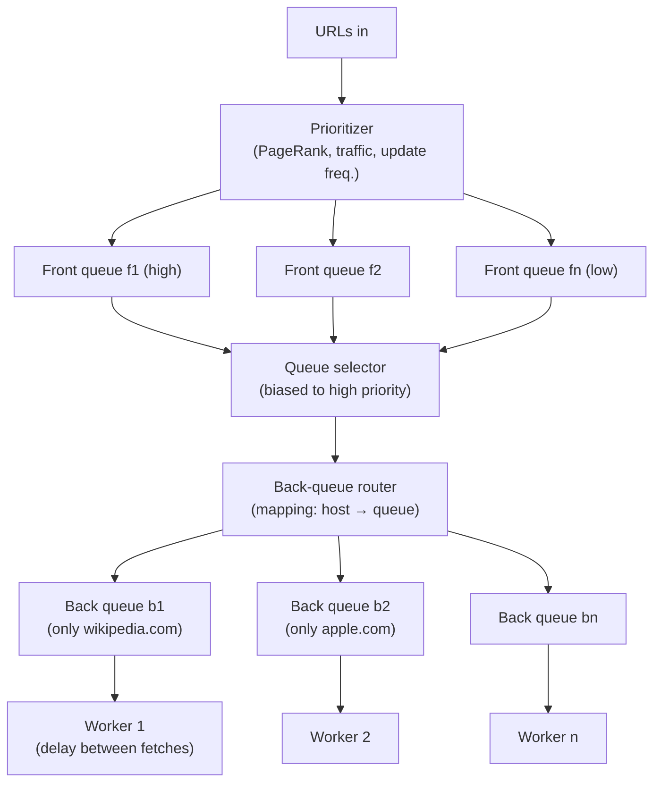

# Chapter 9 — Design a Web Crawler

> **In one line:** A robot that starts from a few URLs, downloads pages, extracts links, and keeps going, collecting **a billion pages a month** politely and efficiently.
>
> **Uses:** search engine indexing (Googlebot), web archiving, web mining, copyright and trademark monitoring.



*The crawl loop: frontier → downloader → parser → content dedupe → link extractor → URL dedupe → back to frontier.*

---

## 1. The basic algorithm
1. Start with a set of **seed URLs**.
2. Download those pages.
3. Extract URLs from them.
4. Add new URLs to the to-do list. Repeat.

It sounds simple, but at scale it's hard.

## 2. Requirements and estimation
- **Purpose:** search engine indexing. **1 billion pages/month.** HTML only. Store pages for **5 years**. Ignore duplicate content.
- Qualities: **scalability** (parallel), **robustness** (bad HTML, crashes, traps), **politeness** (don't hammer a site), **extensibility** (new content types later).

```
QPS          = 1B / 30 days / 86,400 ≈ 400 pages/s (peak ≈ 800)
Storage      = 1B × 500 KB = 500 TB/month
5 years      = 500 TB × 12 × 5 = 30 PB
```

---

## 3. High-level design



| Component | Simple explanation |
|---|---|
| **Seed URLs** | Starting points. Pick popular sites per country or topic. |
| **URL frontier** | The **to-do list** of URLs (a FIFO queue, made smarter below) |
| **HTML downloader** | Fetches pages over HTTP |
| **DNS resolver** | URL → IP (a slow step, so cache it) |
| **Content parser** | Validates and parses HTML. Malformed pages are dropped. |
| **Content seen?** | About 29% of pages are duplicates. Compare **hashes** of content, not full text. |
| **Link extractor** | Pulls links out and turns relative links into absolute ones |
| **URL filter** | Excludes blocked sites, error links, certain file types |
| **URL seen?** | Avoid re-adding visited URLs. Uses a **Bloom filter** or hash table. |

---

## 4. Deep dive

### 4.1 DFS vs BFS
The web is a **graph**. DFS can go infinitely deep, so use **BFS** (a FIFO queue). But plain BFS has two problems:
1. **Impolite:** most links on a page point to the **same host**, so the crawler floods that host.
2. **No priority:** a random forum post gets the same weight as Apple's homepage.

### 4.2 The URL frontier ⭐⭐ (solves both)

- **Front queues = priority.** Important URLs are picked more often.
- **Back queues = politeness.** Each queue holds URLs of **one host only**, and each worker waits between downloads from it.
- **Freshness:** recrawl pages based on how often they change and how important they are.
- **Storage:** millions of URLs, so keep most of the frontier **on disk** with in-memory **buffers** for enqueue and dequeue.

### 4.3 HTML downloader
- **robots.txt (Robots Exclusion Protocol):** check which paths are allowed. Cache the file per site.
- **Performance optimisations:**
  | Trick | Why |
  |---|---|
  | **Distributed crawl** | Many servers, many threads, URL space partitioned |
  | **Cache DNS** | DNS takes 10–200 ms and is often synchronous, so it's a bottleneck |
  | **Locality** | Put crawl servers close to the websites' regions |
  | **Short timeout** | Don't wait forever on slow servers |

### 4.4 Robustness
- **Consistent hashing** to spread load across downloader servers.
- **Save crawl state** so a crash can resume.
- **Handle exceptions** gracefully, without crashing the whole system.
- **Validate data** to avoid errors.

### 4.5 Extensibility
Plug in new modules, for example a **PNG downloader** or a **web monitor** for copyright infringement, next to the link extractor.

### 4.6 Problematic content
| Problem | Solution |
|---|---|
| Redundant content | Content hashes / checksums |
| **Spider traps** (infinite URLs like `/foo/bar/foo/bar/...`) | Max URL length, manual blocklists |
| Data noise (ads, spam, code snippets) | Filter it out |

---

## 5. Wrap-up topics
- **Server-side rendering** for JavaScript-generated links. Render the page first, then parse.
- **Filter out unwanted pages** (anti-spam).
- **Database replication and sharding.**
- **Horizontal scaling:** keep servers **stateless**.
- Availability, consistency, reliability. **Analytics.**

---

## 🧠 Cheat sheet
- Loop: **frontier → download → parse → dedupe content → extract links → dedupe URLs → frontier**.
- BFS, but the **frontier** has **priority front queues** and **politeness back queues** (one host per queue).
- **robots.txt**, **DNS cache**, short timeouts, geographic locality.
- **Bloom filter** for URL-seen. **Hashes** for content-seen.
- Beware **spider traps**.

## ✅ Self-check
<details><summary>1. How does the frontier enforce politeness?</summary>
Each back queue holds URLs of only one host, and a worker downloads from it with a delay between requests.
</details>
<details><summary>2. Why cache DNS?</summary>
DNS lookups are slow (10–200 ms) and often synchronous, so they become a crawler bottleneck.
</details>
<details><summary>3. What is a spider trap?</summary>
A page that generates infinite links (for example deep loops of directories). Avoid it with URL length limits and blocklists.
</details>

---
[⬅️ Chapter 8 · URL Shortener](08-Design-A-URL-Shortener.md) | [Next: Chapter 10 · Notification System ➡️](10-Design-A-Notification-System.md)
