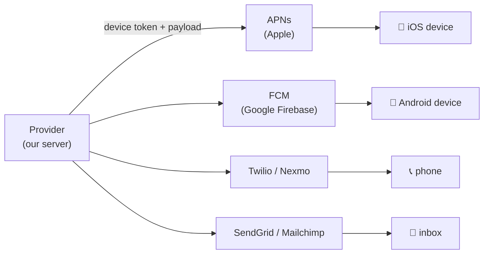
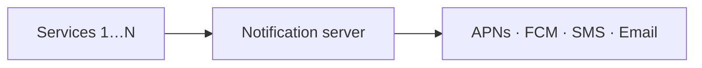
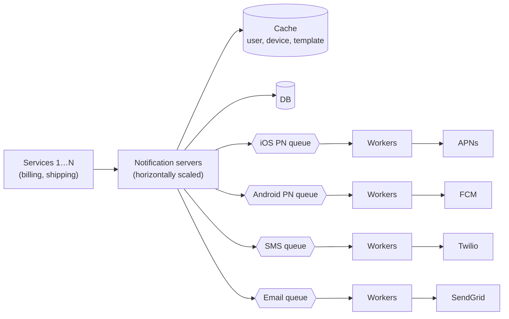
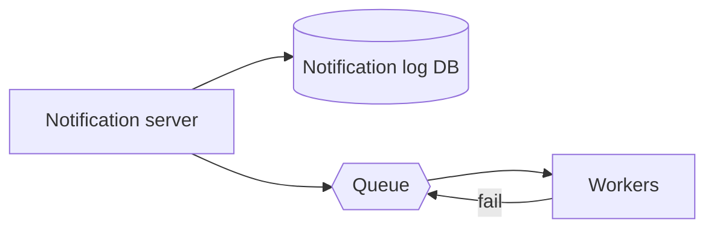
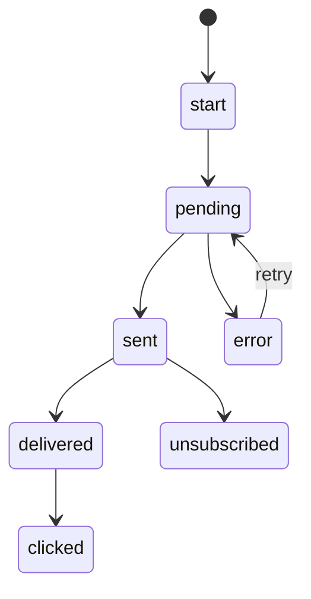
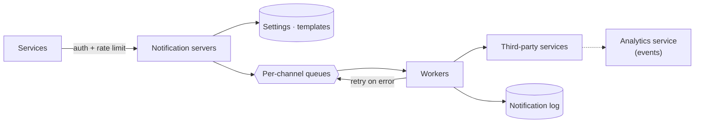

# Chapter 10 — Design a Notification System

> **In one line:** Deliver **10 million push, 1 million SMS and 5 million emails a day** (news, reminders, payment alerts) reliably and without spamming users.



*A service triggers a notification, it's routed to a per-channel queue, workers send it via a third-party provider, and failures are retried.*

---

## 1. Requirements
- **Types:** iOS push, Android push, SMS, email.
- **Soft real time:** deliver as soon as possible. A small delay is fine under high load.
- **Devices:** iOS, Android, laptop/desktop.
- **Triggers:** client apps or server-side scheduled jobs.
- **Opt-out** must be respected.

---

## 2. How each notification type works


| Type | Needs | Third party |
|---|---|---|
| iOS push | **Device token** + JSON payload | Apple Push Notification Service |
| Android push | Device token | Firebase Cloud Messaging |
| SMS | Phone number | Twilio, Nexmo |
| Email | Email address | SendGrid, Mailchimp (better delivery rates and analytics than running your own SMTP servers) |

### Gathering contact info
When the user installs the app or signs up, the API servers store the **device token**, phone number and email in the DB.
```text
user   (user_id, email, country_code, phone_number, created_at)
device (id, device_token, user_id, last_logged_in_at)   -- a user can have many devices
```

---

## 3. Version 1: a single notification server (problems)

❌ **SPOF.** ❌ Hard to scale (DB, cache and processing all in one place). ❌ **Performance bottleneck**: building HTML and waiting on third parties is slow.

## 4. Version 2: improved design ✅

- **DB and cache** are moved out of the notification server.
- **More servers** with autoscaling.
- **Message queues** decouple components, and there's **one queue per channel**, so a third-party outage (say, SMS) doesn't affect the others.

**Flow:** a service calls the API → servers fetch metadata (token, settings) from cache/DB → the event goes onto the right queue → workers pull it and send via the third party → the third party delivers to the device.

---

## 5. Deep dive

### 5.1 Reliability: never lose a notification ⭐

- Persist notifications in a **notification log** and **retry** on failure.
- **Exactly once?** It's impossible in general. Reduce duplicates with **dedupe**: check whether this **event ID** was seen before, and discard it if so.

### 5.2 Additional components
| Component | Why |
|---|---|
| **Notification templates** | Reusable, consistently formatted messages with parameters ("Your order {item} ships {date}") |
| **Notification settings** | Per-user, per-channel **opt-in/opt-out**. Check before sending. |
| **Rate limiting** | Cap notifications per user so they don't **turn notifications off entirely** |
| **Retry mechanism** | Failed sends go back to the queue. Alert devs if failures persist. |
| **Security** | Only authenticated clients (`appKey` / `appSecret`) can send notifications through our APIs |
| **Monitor queued notifications** | A growing queue means more workers are needed |
| **Event tracking** | Track open rate, click rate, engagement through analytics |

### Notification lifecycle (tracked events)


### 5.3 Updated design


---

## 🧠 Cheat sheet
- Channels: **APNs, FCM, SMS (Twilio), email (SendGrid)**.
- **Decouple with per-channel message queues** plus horizontally scaled workers.
- **Reliability:** notification log + retries + **dedupe by event ID**.
- Respect **opt-out settings**, **rate-limit** per user, use **templates**.
- Authenticate senders. Monitor queue depth. Track delivery and clicks.

## ✅ Self-check
<details><summary>1. Why one queue per channel?</summary>
Isolation. If one provider (for example SMS) is down, other channels keep flowing.
</details>
<details><summary>2. Can we guarantee exactly-once delivery?</summary>
No. Retries can cause duplicates, so we reduce them with event-ID dedupe checks.
</details>
<details><summary>3. Why rate-limit notifications per user?</summary>
Too many notifications annoy users, who may disable notifications completely.
</details>

---
[⬅️ Chapter 9 · Web Crawler](09-Design-A-Web-Crawler.md) | [Next: Chapter 11 · News Feed ➡️](11-Design-A-News-Feed-System.md)
