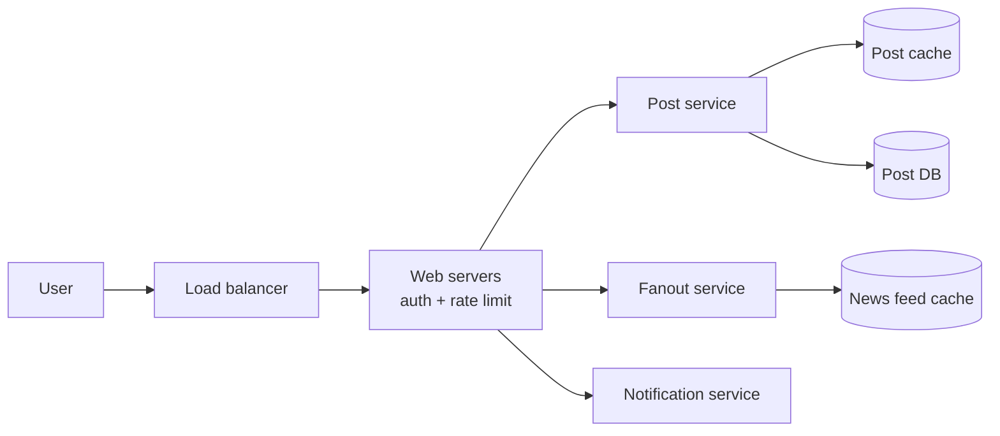
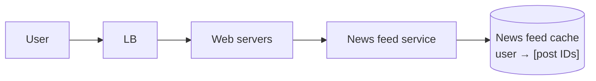
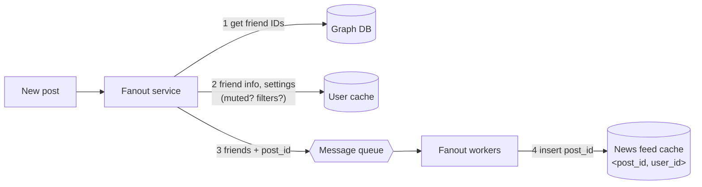
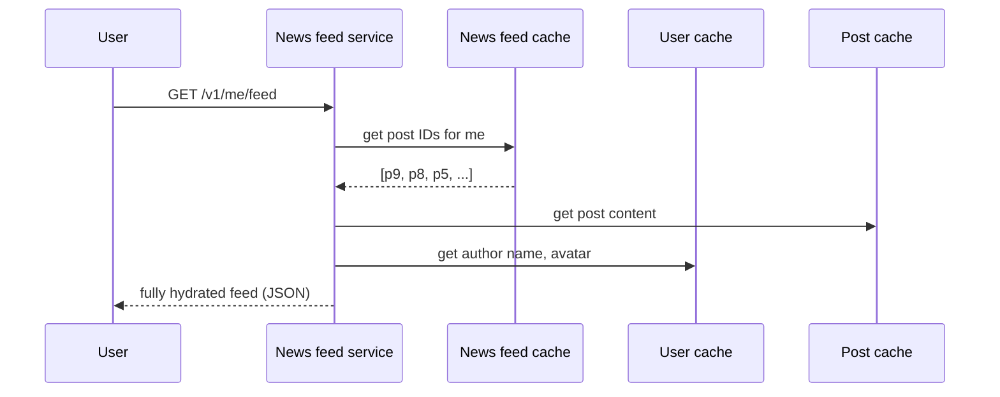

# Chapter 11 — Design a News Feed System

> **In one line:** When you open Facebook, Instagram or Twitter, show a constantly updating list of posts from people you follow, built fast for **10 million DAU**.



*Orange: publishing a post and fanning it out to friends' feed caches. Indigo: reading a feed.*

---

## 1. Requirements
- Mobile and web. A user can **publish a post** and **see friends' posts** on their feed.
- Order: **reverse chronological** (keep it simple).
- Up to **5,000 friends** per user. **10M DAU.** Posts can include images and videos.

## 2. Two flows, two APIs
```http
POST /v1/me/feed   { content, auth_token }   # publish a post
GET  /v1/me/feed   { auth_token }            # retrieve my news feed
```

---

## 3. High-level design

### 3.1 Feed publishing


### 3.2 News feed building


---

## 4. Deep dive: fanout ⭐⭐
**Fanout** = delivering a post to all friends. There are two models:

| | **Fanout on write (push)** | **Fanout on read (pull)** |
|---|---|---|
| When | Feed is **pre-computed** when a post is published | Feed is built **when the user opens it** |
| Read speed | ✅ Instant | ❌ Slow |
| Write cost | ❌ Heavy for users with many friends: the **hotkey / celebrity problem** | ✅ Cheap |
| Inactive users | ❌ Wasted work | ✅ No waste |

### ✅ Hybrid approach
- **Most users → push** (fast reads).
- **Celebrities / users with many followers → pull.** Followers fetch the celebrity's posts on demand and merge them in.
- **Consistent hashing** spreads requests and data to reduce hotkeys.

### The fanout service in detail

**Memory trick:** the feed cache stores **only IDs** (`post_id, user_id`), not full objects. A cap (for example the latest **500** posts) keeps it small, because users rarely scroll deeper. Older posts are fetched from the DB on a cache miss.

---

## 5. Deep dive: news feed retrieval

Media (images and videos) are served from a **CDN**.

---

## 6. Cache architecture (5 layers) ⭐
| Layer | Holds |
|---|---|
| **News feed** | Feed post IDs per user |
| **Content** | Post data. **Hot** (popular) posts kept in a separate cache. |
| **Social graph** | Follower / following relationships |
| **Action** | Likes, replies, shares per post |
| **Counters** | Like count, reply count, follower count… |

---

## 7. Wrap-up: scaling topics
- **Database:** vertical vs horizontal scaling, SQL vs NoSQL, master-slave replication, read replicas, consistency models, **sharding**.
- Keep the web tier **stateless**. **Cache** as much as possible. Multi-DC.
- **Message queues** to loosely couple components.
- **Monitor** key metrics: QPS at peak, latency when users refresh the feed.

---

## 🧠 Cheat sheet
- Two flows: **publish** and **retrieve**.
- **Fanout on write** (fast reads) vs **on read** (no wasted work) → **hybrid**: celebrities use pull.
- Fanout: **graph DB → user cache (filters) → queue → workers → feed cache**.
- The feed cache stores only **IDs**, capped at about 500 per user.
- Retrieval **hydrates** IDs with post and user caches. Media via the **CDN**.

## ✅ Self-check
<details><summary>1. Why not use fanout-on-write for celebrities?</summary>
Writing one post into millions of followers' feeds is slow and expensive (the hotkey problem).
</details>
<details><summary>2. Why store only IDs in the feed cache?</summary>
To save memory. Content is fetched from the post and user caches during retrieval.
</details>
<details><summary>3. What does the user cache filter during fanout?</summary>
Friend settings such as muted users or selective sharing, so posts only go to eligible friends.
</details>

---
[⬅️ Chapter 10 · Notifications](10-Design-A-Notification-System.md) | [Next: Chapter 12 · Chat System ➡️](12-Design-A-Chat-System.md)
