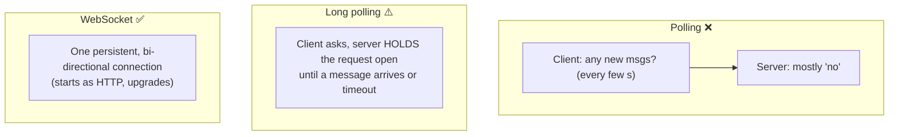
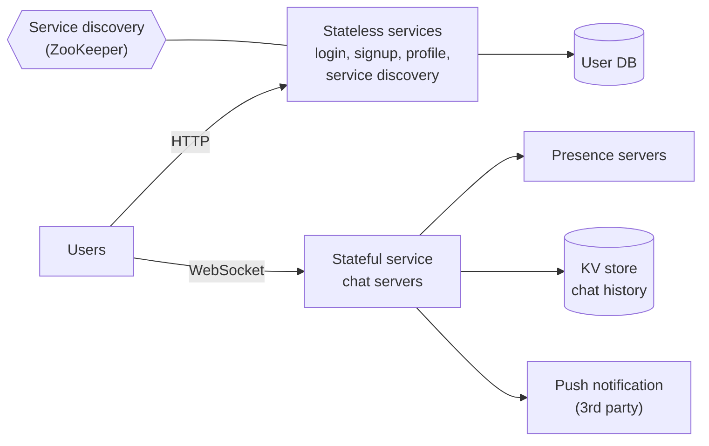
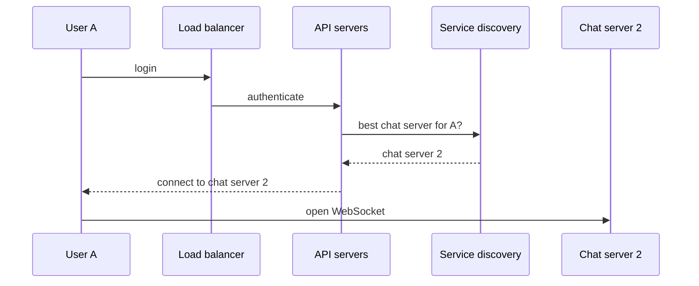
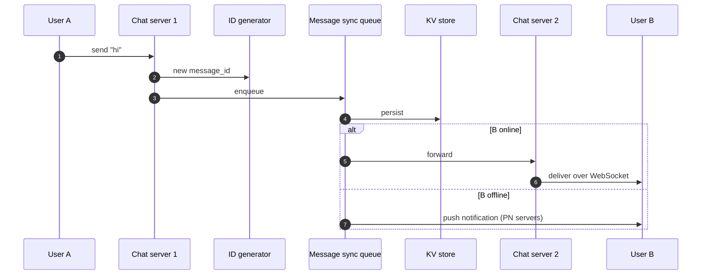
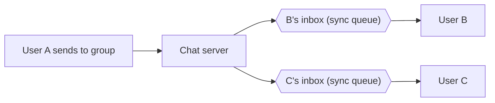
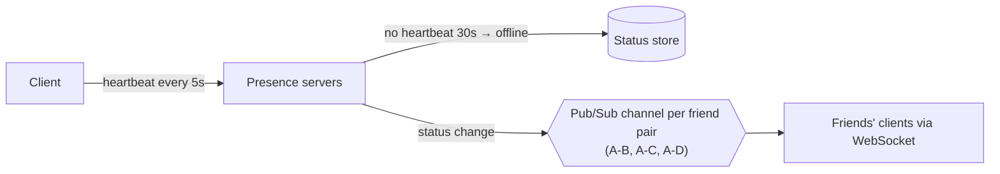

# Chapter 12 — Design a Chat System

> **In one line:** Build a WhatsApp / Messenger / Slack-like app: one-on-one and small group chats, online presence, multi-device sync, and push notifications, for **50 million DAU**.



*User A's message gets an ID, goes into B's sync queue, is stored, and is pushed over B's WebSocket (or as a push notification if B is offline).*

---

## 1. Requirements
- **One-on-one chat** with low delivery latency. **Small group chat** (max 100 people).
- **Online presence** indicator. **Multiple devices** per account.
- **Push notifications.** Text only, max 100,000 characters. Chat history stored **forever**.

---

## 2. How does the server talk to the client? ⭐⭐
Sending is easy: the client makes an HTTP request. **Receiving** is the hard part, because the server must reach the client.


| Technique | Problem |
|---|---|
| Polling | Wasteful: most answers are "nothing new" |
| Long polling | Sender and receiver may hit different servers. The server can't tell if a client disconnected. Still inefficient for inactive users. |
| **WebSocket** ✅ | Two-way, persistent, works through firewalls (ports 80/443). Use it for **both** sending and receiving. |

---

## 3. High-level design: three parts


| Part | Notes |
|---|---|
| **Stateless services** | Classic request/response behind a load balancer. **Service discovery** gives the client the best chat server to connect to. |
| **Stateful service** | Chat servers: each client keeps a **persistent connection** to one server |
| **Third-party integration** | Push notifications for offline users |

### Storage: which database for chat history?
- The volume is **enormous** (Facebook/WhatsApp ≈ 60 billion messages/day).
- Only **recent** chats are read often. Random access is needed for search, mentions and jumping to a message.
- Read:write ratio is about 1:1.

✅ **Key-value store** (HBase is used by Facebook Messenger, Cassandra by Discord). It scales horizontally with low latency, and relational DBs struggle with the long tail of data.

---

## 4. Data model
```text
-- one-on-one
message       (message_id PK bigint, message_from, message_to, content, created_at)

-- group
group_message (channel_id, message_id) PK, user_id, content, created_at
```
**`message_id` must be unique and sortable by time.** `created_at` isn't enough, because two messages can share a timestamp.
- Option 1: a global ID generator like **Snowflake** (Ch 7).
- Option 2: a **local sequence number** generator, unique **per channel / per one-on-one chat**. That is easier and sufficient, because order only matters within a chat.

---

## 5. Deep dive

### 5.1 Service discovery
Recommends the best chat server for a client (by location, server capacity…). **Apache ZooKeeper** registers all chat servers.



### 5.2 One-on-one message flow


### 5.3 Message sync across multiple devices ⭐
Each device stores **`cur_max_message_id`**, the latest message ID it has seen. On connect, it fetches messages where:
- recipient = the logged-in user, and
- `message_id > cur_max_message_id`.

So every device independently catches up on missed messages.

### 5.4 Small group chat

Messages are **copied into each member's message sync queue** (an inbox). Each recipient just checks their own inbox. This is simple, and fine for small groups (WeChat caps groups at 500). It isn't suitable for huge groups.

### 5.5 Online presence ⭐
- **Login:** set status `online` and `last_active_at` in the KV store.
- **Logout:** set status `offline`.
- **Disconnects:** a flaky network shouldn't toggle the status constantly. Use a **heartbeat**: the client sends one every 5 s, and if none arrives for 30 s, the user is marked offline.


**Fanout of status changes** uses a **publish-subscribe** model: one channel per friendship pair, which works for small groups. For big groups (100k members), fetch status only **when the user opens the group** or refreshes the member list.

---

## 6. Wrap-up: extra topics
- **Media files** (photos, videos): compression, cloud storage, thumbnails.
- **End-to-end encryption:** only sender and recipient can read messages.
- **Client-side caching** to reduce data transfer.
- **Faster load times:** a geographically distributed network (like Slack's) to cache users' data, channels…
- **Error handling:** chat server failure means the client reconnects to a new server from service discovery. **Message resend** with retry and queueing.

---

## 🧠 Cheat sheet
- **WebSocket** for real-time, two-way messaging.
- **Stateless** (HTTP) + **stateful** (chat servers) + **third party** (push).
- **KV store** (HBase/Cassandra) for history. **Sortable message IDs** per chat.
- **Service discovery** (ZooKeeper) picks a chat server.
- Multi-device: `cur_max_message_id` per device.
- Groups: copy into each member's inbox (small groups only).
- Presence: **heartbeats** plus **pub/sub** fanout.

## ✅ Self-check
<details><summary>1. Why is WebSocket better than long polling for chat?</summary>
It is a single persistent two-way connection. Long polling wastes resources and can't easily tell when a client has gone.
</details>
<details><summary>2. How do multiple devices stay in sync?</summary>
Each device remembers the max message ID it has seen and fetches everything newer when it reconnects.
</details>
<details><summary>3. How is "offline" detected without flicker on bad networks?</summary>
With periodic heartbeats. Only after missing heartbeats for a timeout (for example 30 s) is the user marked offline.
</details>

---
[⬅️ Chapter 11 · News Feed](11-Design-A-News-Feed-System.md) | [Next: Chapter 13 · Search Autocomplete ➡️](13-Design-A-Search-Autocomplete-System.md)
