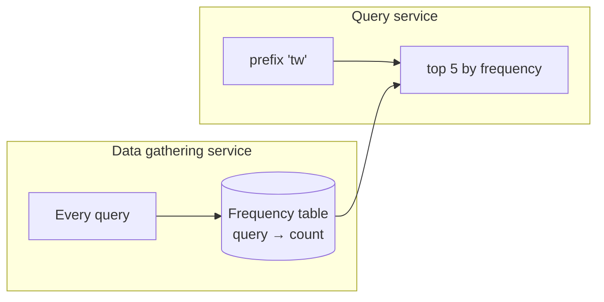
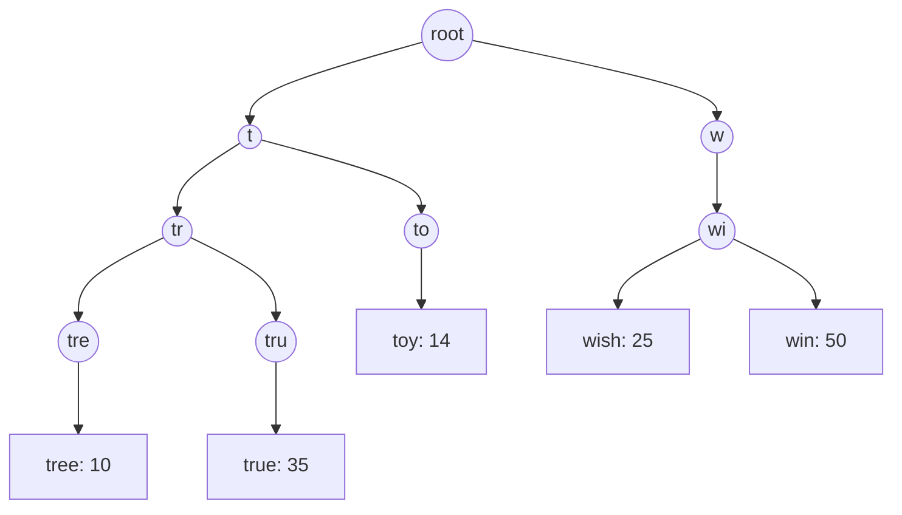
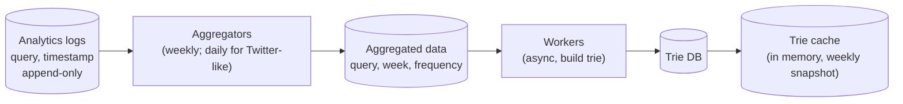
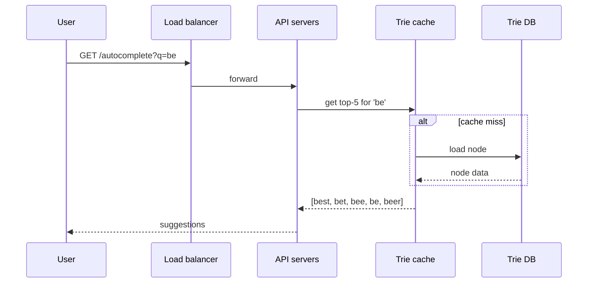
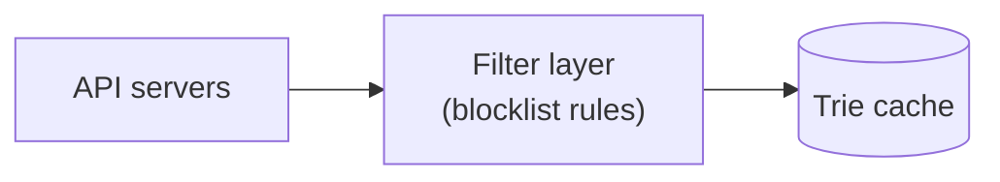
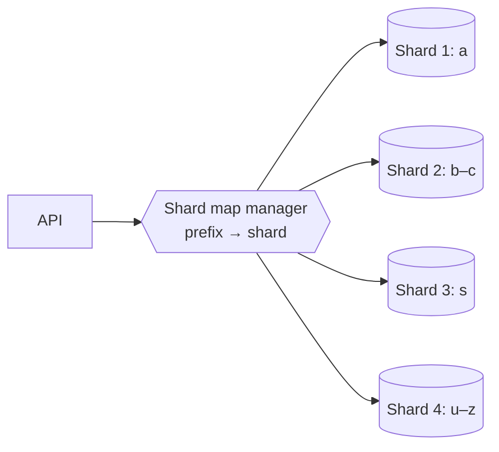

# Chapter 13 — Design a Search Autocomplete System

> **In one line:** As you type "din" into a search box, instantly suggest the **top 5 most popular** queries that start with it ("dinner", "dinosaur"…).
>
> Also called *typeahead*, *search-as-you-type* or *incremental search*.



*Indigo: a keystroke reads pre-computed suggestions from the trie cache. Orange: logs are aggregated weekly to rebuild the trie.*

---

## 1. Requirements and estimation
- Matching is on the **beginning** of the query (prefix). Return the **top 5** by **popularity** (historical frequency).
- No spell-check. English, lowercase only.
- **Fast response: < 100 ms**, or the UI stutters. Relevant, sorted, scalable, highly available.

```
10M DAU · 10 searches/day · 20 bytes per query
Each keystroke = 1 request → ~20 requests per search
QPS        = 10M × 10 × 20 / 86,400 ≈ 24,000   (peak ≈ 48,000)
New data   ≈ 20% of queries are new → ~0.4 GB/day
```

---

## 2. High-level design: two services

A naive SQL `WHERE query LIKE 'tw%' ORDER BY frequency DESC LIMIT 5` is far too slow at scale. We need a better data structure.

---

## 3. Deep dive: the trie (prefix tree) ⭐⭐⭐

A tree where **each node is a character** and a path from the root spells a prefix.


Each complete word stores its **frequency**.

### Naive lookup cost
1. Find the prefix node: **O(p)** (p = prefix length).
2. Traverse its whole subtree to collect all words: **O(c)** (c = number of children).
3. Sort them to get the top k: **O(c log c)**.

That is too slow for a large subtree.

### Two optimisations ✅
1. **Limit prefix length.** Users rarely type long queries, so cap it at about 50 characters. Finding the node becomes **O(1)**.
2. **Cache the top-k queries at every node.** Each node stores its top 5 directly, so there is no subtree walk and no sorting.

```
node "be" → cached top 5: [best: 35, bet: 29, bee: 20, be: 15, beer: 10]
```
**Result: an O(1) lookup.** The trade-off is more space, which is worth it for speed.

---

## 4. Data gathering service (not real time!)
Updating the trie on **every** query (billions a day) would slow it down, and top suggestions don't change that fast. So update it **in batches**.



### Where to store the trie?
| Option | How |
|---|---|
| **Document store** (MongoDB) | Serialise the whole trie as a weekly snapshot |
| **Key-value store** | Each **prefix → node data** (its top-5 list) as a hash table entry ✅ |

---

## 5. Query service flow

**Speed tricks:**
- **AJAX** requests, so the page doesn't reload.
- **Browser caching:** results for a prefix don't change often (Google caches them for about 1 hour, `Cache-Control: max-age=3600`).
- **Data sampling:** log only 1 in N queries to save processing.
- **Debounce** keystrokes on the client.

---

## 6. Trie operations
| Operation | How |
|---|---|
| **Create** | Workers rebuild weekly from aggregated data |
| **Update** | Option 1: **replace weekly** (preferred). Option 2: update a node and **all its ancestors' top-5 lists** (slow). |
| **Delete** | Hateful, violent or dangerous suggestions: add a **filter layer** in front of the trie cache, and remove them from the DB asynchronously |



---

## 7. Scaling storage: sharding the trie
- Naive: split by the **first letter** (a–m on shard 1, n–z on shard 2), or 26 shards, one per letter.
- ⚠️ **Uneven:** far more words start with "c" than "x".
- ✅ Use a **shard map manager** that analyses historical data distribution, for example `s` alone gets one shard while `u–z` share one.



---

## 8. Wrap-up topics
- **Multi-language support:** store Unicode characters in trie nodes.
- **Country-specific** top queries: build a separate trie per country and serve it from a CDN.
- **Real-time trending** queries (breaking news): weekly batches are too slow. Ideas include reducing the working set via sharding, weighting recent queries more, and using **stream processing** (Kafka, Spark Streaming, Storm).

---

## 🧠 Cheat sheet
- A **trie** with **top-5 cached at every node** and a **capped prefix length** gives O(1) lookups.
- **Batch rebuild** (weekly) from aggregated **analytics logs**. Not real time.
- Store the trie in a **KV store** (prefix → top-5) and serve it from an in-memory **trie cache**.
- Client: AJAX, **browser cache**, debounce. Server: **filter layer** for unsafe suggestions.
- Shard by prefix using a **shard map** based on real data distribution.

## ✅ Self-check
<details><summary>1. Why cache the top 5 at every trie node?</summary>
To avoid traversing and sorting the whole subtree on every keystroke. The answer is read directly in O(1).
</details>
<details><summary>2. Why not update the trie in real time?</summary>
Billions of updates would slow the trie down, and top suggestions change slowly, so weekly batches are enough.
</details>
<details><summary>3. Why is sharding by first letter a bad idea?</summary>
The letter distribution is very uneven, which creates hot shards. Use a data-driven shard map instead.
</details>

---
[⬅️ Chapter 12 · Chat](12-Design-A-Chat-System.md) | [Next: Chapter 14 · YouTube ➡️](14-Design-YouTube.md)
