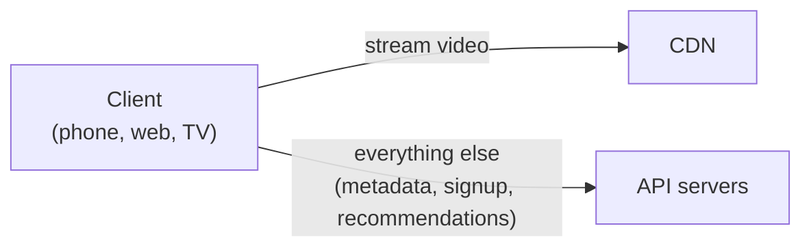
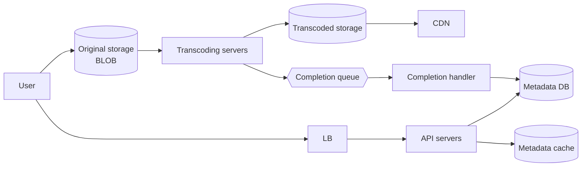
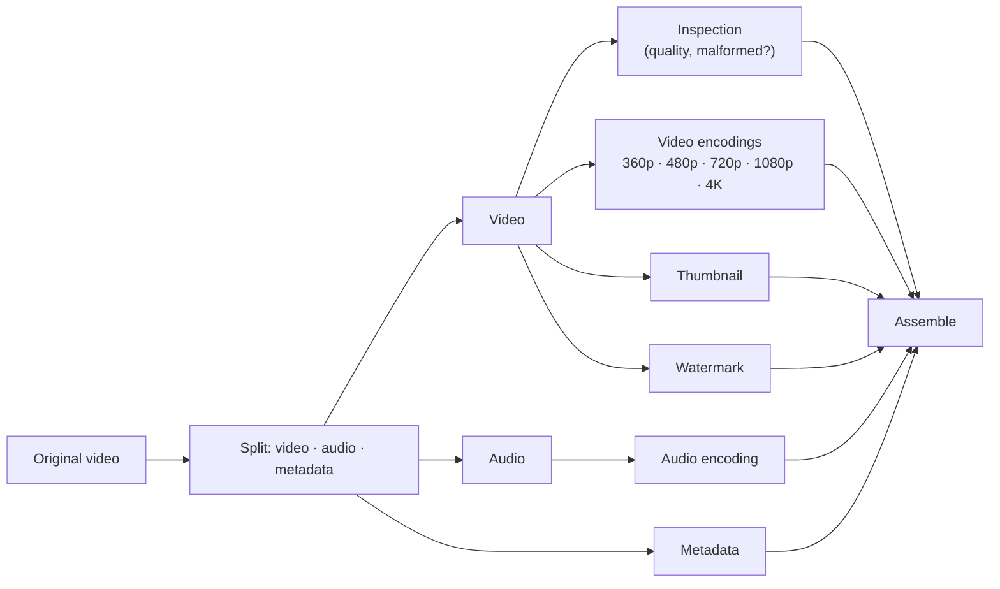
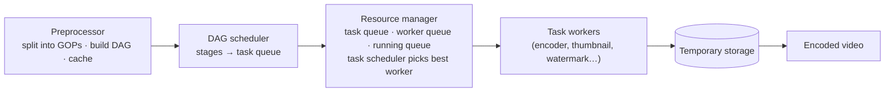
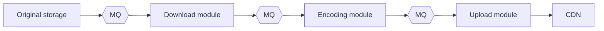

# Chapter 14 — Design YouTube

> **In one line:** Let creators **upload** videos and let millions **watch** them smoothly on any device and network, while keeping the huge CDN bill under control.



*Orange: upload → original storage → transcoding → transcoded storage → CDN. Indigo: a viewer streams from the nearest CDN edge.*

---

## 1. Requirements and estimation
- **Upload** and **watch** videos quickly. Smooth streaming that adapts to quality. Multiple devices and resolutions.
- Max file size **1 GB**. Encryption. Low infrastructure cost.
- High availability, scalability, reliability. Use existing cloud services (CDN, blob storage).

```
5M DAU · 5 videos watched/day · 10% upload 1 video/day · avg 300 MB
Daily storage = 5M × 10% × 300 MB = 150 TB/day
CDN cost (AWS CloudFront ~$0.02/GB): 5M × 5 × 0.3 GB × $0.02 ≈ $150,000/day 💸
```
**Cost is a major design driver.**

---

## 2. High-level design: three parts


### 2.1 Upload flow

Two things happen **in parallel**:
1. **The actual video upload:** bytes go to original storage, then transcoding, then transcoded storage, then the CDN, and a completion event updates the metadata.
2. **Metadata update:** the client sends the title, description, size and so on to the API servers.

### 2.2 Video streaming flow
**Streaming** means playback starts **immediately** and continues while the rest downloads, rather than waiting for the whole file. Video comes from the **closest CDN edge**.

**Streaming protocols** standardise how data is sent: **MPEG-DASH**, **Apple HLS**, Microsoft Smooth Streaming, Adobe HDS. Different protocols support different encodings and players.

---

## 3. Deep dive: video transcoding ⭐⭐

### Why transcode?
- Raw video is **huge**: an hour of HD at 60fps can be hundreds of GB.
- Devices and browsers support different formats.
- Smooth playback needs **multiple bitrates**: low quality on slow networks, high on fast ones. **Adaptive bitrate streaming** switches between them automatically.
- Network conditions change during playback.

**Encoding format = container + codec.** The **container** (.mp4, .mov, .avi) is the "box" holding video, audio and metadata. **Codecs** (H.264, VP9, HEVC) are the compression algorithms.

### The DAG model (Facebook-style)
Different creators need different processing (watermarks, thumbnails, quality levels). Model the work as a **directed acyclic graph** of tasks that can run **in parallel**:



### Video transcoding architecture

| Component | Simple job |
|---|---|
| **Preprocessor** | Splits video into **GOPs** (Groups of Pictures, independently playable chunks of a few seconds). Generates the DAG from config. Caches segments for retries. |
| **DAG scheduler** | Splits the DAG into **stages** of tasks and puts them in the task queue |
| **Resource manager** | Matches the highest-priority task with the best available worker. Tracks running tasks. |
| **Task workers** | Run the tasks defined in the DAG |
| **Temporary storage** | Metadata in memory, video/audio in blob storage. Freed when done. |
| **Encoded video** | The final output, for example `funny_720p.mp4` |

---

## 4. System optimisations ⭐

### Speed
- **Parallelise upload:** split the video into GOP-aligned chunks **on the client** and upload them in parallel. Resume after failure.
- **Upload centres close to users** (use the CDN as upload endpoints).
- **Parallelism everywhere:** put **message queues** between every stage (download → encode → upload) so they don't wait on each other.



### Safety
- **Pre-signed upload URLs:** the client asks the API for a signed URL, then uploads **directly** to storage, but only with permission.
- **Copyright protection:** DRM (Apple FairPlay, Google Widevine, Microsoft PlayReady), **AES encryption**, visual watermarking.

### Cost ⭐ (the CDN is the biggest bill)
YouTube views follow a **long-tail** distribution: a few videos get most views, and most get very few.

| Optimisation | Idea |
|---|---|
| **CDN only for popular videos** | Serve the long tail from high-capacity **storage video servers** |
| **Encode less for unpopular content** | Fewer versions, or encode on demand |
| **Regional popularity** | Some videos are popular only in some regions, so don't push them to every CDN |
| **Build your own CDN** | Like Netflix, partnering with ISPs (Open Connect) |

---

## 5. Error handling
| Error | Handling |
|---|---|
| **Recoverable** (a segment failed to transcode) | **Retry** a few times, then return an error code |
| **Non-recoverable** (malformed video) | Stop tasks, return an error |
| Upload error | Retry |
| Split video error | Server-side splitting if the old client can't split by GOP |
| Transcoding error | Retry |
| Preprocessor / DAG scheduler error | Reschedule the task |
| Resource manager queue down | Use a replica |
| Task worker down | Retry on a new worker |
| API server down | Stateless, so route to another server |
| Metadata cache / DB down | Replicas. Promote a slave. |

---

## 🧠 Cheat sheet
- **CDN for streaming, API servers for everything else.**
- Upload → **original storage** → **transcoding (DAG)** → **transcoded storage** → **CDN**, with metadata updated in parallel.
- Transcoding: **GOPs**, **DAG scheduler**, **resource manager**, workers. Multiple bitrates for **adaptive streaming**.
- Speed: parallel chunked upload, nearby upload centres, **queues between stages**.
- Safety: **pre-signed URLs**, DRM, encryption.
- Cost: **CDN only for popular videos**, the long tail from storage servers.

## ✅ Self-check
<details><summary>1. Why transcode into multiple resolutions?</summary>
So players can do adaptive bitrate streaming, switching quality to match the device and network in real time.
</details>
<details><summary>2. What is a GOP and why split by it?</summary>
A Group of Pictures is a chunk of frames that plays independently. Splitting by GOP allows parallel upload and transcoding.
</details>
<details><summary>3. How do you cut CDN costs?</summary>
Serve only popular videos via the CDN, serve the long tail from storage servers, and encode unpopular videos less.
</details>

---
[⬅️ Chapter 13 · Autocomplete](13-Design-A-Search-Autocomplete-System.md) | [Next: Chapter 15 · Google Drive ➡️](15-Design-Google-Drive.md)
