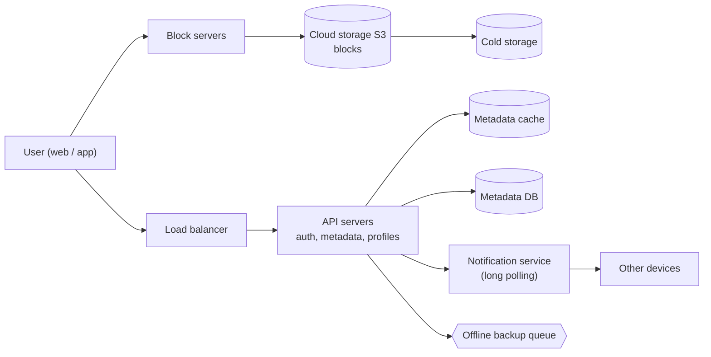
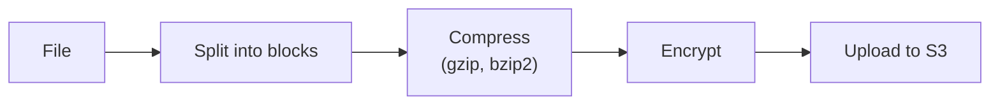
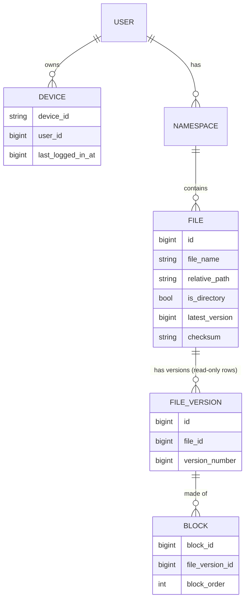
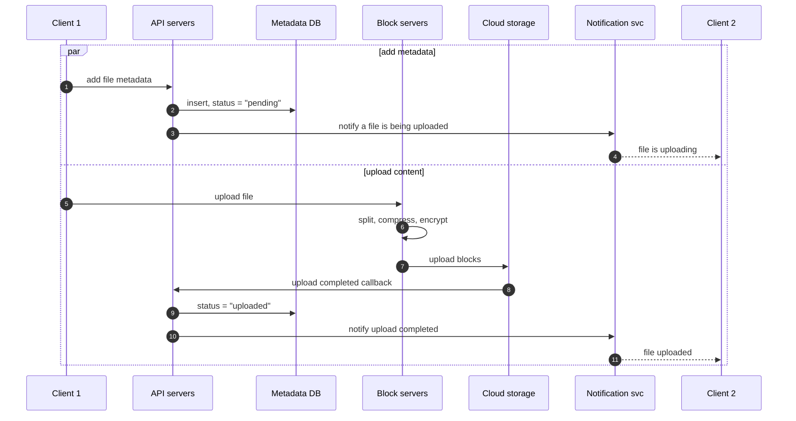

# Chapter 15 — Design Google Drive

> **In one line:** Store files in the cloud, **sync** them across all your devices, keep **versions**, and share them, for **10 million DAU**.
>
> **Similar products:** Dropbox, OneDrive, iCloud Drive.



*Orange: a laptop uploads only the changed blocks of a file. Indigo: the notification service tells the phone, which then syncs.*

---

## 1. Requirements and estimation
- **Upload / download files**, **sync across devices**, **file revisions**, **share** with friends, **notifications** when a file is edited, deleted or shared.
- Any file type. Max size **10 GB**. Encrypted at rest.
- **Reliability is critical:** data loss is unacceptable. Fast sync. Low bandwidth. Scalable, highly available.

```
50M signed up, 10M DAU, 10 GB free each
Total space   = 50M × 10 GB = 500 PB
Uploads       = 10M × 2 files/day × 500 KB
Upload QPS    = 10M × 2 / 86,400 ≈ 240 (peak ≈ 480)
```

---

## 2. Start simple, then scale

### Version 1: one server
- Apache web server + MySQL + a `drive/` directory with one **namespace** (folder) per user.
- APIs:
  ```http
  POST /files/upload?uploadType=resumable    # simple or resumable upload
  GET  /files/download?path=/recipes/soup/best_soup.txt
  GET  /files/list_revisions?path=...&limit=20
  ```
- Over HTTPS with authentication.

The disk eventually fills up, so we move to **sharding**, then to **Amazon S3**, which replicates within and across regions for durability.

### Version 2: improved architecture

| Component | Simple job |
|---|---|
| **Block servers** | Split files into **blocks** (max 4 MB, as Dropbox does), **compress**, **encrypt**, and upload them to S3. Each block has a **hash**. |
| **Cloud storage** | Stores the blocks |
| **Cold storage** | Inactive files, cheaper (for example S3 Glacier) |
| **API servers** | Everything except the upload flow: auth, profiles, **metadata** |
| **Metadata DB** | Users, files, blocks, versions. **Not** the file bytes. |
| **Notification service** | Pub/sub that tells clients when a file changed elsewhere |
| **Offline backup queue** | Holds changes for offline devices until they reconnect |

---

## 3. Sync conflicts ⭐
Two users edit the same file at the same time.
**Rule: the first version processed wins.** The later one gets a **conflict**: the user sees both the local copy and the server's latest version and chooses to merge or keep one.

---

## 4. Deep dive

### 4.1 Block servers: saving bandwidth ⭐⭐

Two optimisations:
1. **Delta sync:** when a file changes, **only the modified blocks** are uploaded, found using a sync algorithm and block hashes.
2. **Compression** per block, using an algorithm suited to the file type.

```
File v1: [B1][B2][B3][B4][B5]
File v2: [B1][B2'][B3][B4][B5']   → upload only B2' and B5'
```

### 4.2 High consistency
Different clients must **never** see different versions of a file. So:
- Metadata cache and DB must be **strongly consistent**. Cache replicas must agree, and the cache is **invalidated on DB writes**.
- The metadata DB is **relational** because we need **ACID** (NoSQL lacks it by default).

### 4.3 Metadata database schema

File version rows are **read-only**, which keeps revision history intact.

### 4.4 Upload flow (two requests in parallel)


### 4.5 Download flow
When a file changes elsewhere:
- If the client is **online**, the notification service tells it, and it pulls the latest metadata.
- If it is **offline**, changes wait in the **offline backup queue** and the client pulls when it comes back online.

The client then requests the **changed blocks** from the block servers, which fetch them from S3, and the client **reconstructs** the file.

### 4.6 Notification service: long polling vs WebSocket
Drive uses **long polling** (as Dropbox does):
- Communication is mostly **server → client**, and infrequent, with no burst of data.
- When a change is detected, the client closes the long poll, fetches metadata, then opens a new long poll.

### 4.7 Save storage space 💾
- **De-duplicate** blocks at the account level: same hash means store once.
- **Smart backup:** limit the number of versions kept, and keep **valuable versions** (recent ones weighted more).
- Move infrequently used data to **cold storage** (much cheaper).

### 4.8 Failure handling
| Failure | Handling |
|---|---|
| Load balancer | A secondary takes over (heartbeats) |
| Block server | Other servers pick up unfinished jobs |
| Cloud storage | Replicated across regions, so fetch from another region |
| API server | Stateless, so traffic is redirected |
| Metadata cache | Replicated, so use another node |
| Metadata DB master | Promote a slave |
| Notification service | Clients reconnect to another server (reconnecting millions of long-poll connections is slow, though) |
| Offline backup queue | Replicated, so consumers resubscribe |

---

## 5. Alternative design to discuss
**Upload directly from client to cloud storage** (skipping block servers) is faster, but chunking, compression and encryption logic would have to be implemented on **every platform** (iOS, Android, web), and clients are easier to hack. Keeping that logic **on the server** (block servers) is more secure and easier to maintain.

Moving **online/offline presence** into its own service lets other services reuse it.

---

## 🧠 Cheat sheet
- **Blocks** (≤ 4 MB) + **hashes** → **delta sync** (only changed blocks) + compression + encryption.
- **Metadata** in a relational DB (ACID, strong consistency). **Bytes** in S3. Old data in cold storage.
- Upload = **metadata request + block upload in parallel**, then a status update and notifications.
- **Long polling** for change notifications. **Offline queue** for disconnected devices.
- Conflicts: **first write wins**. The user resolves the rest.
- Save space: **dedupe**, version limits, cold storage.

## ✅ Self-check
<details><summary>1. What is delta sync?</summary>
Uploading only the blocks of a file that changed (detected by block hashes), instead of the whole file.
</details>
<details><summary>2. Why a relational DB for metadata?</summary>
Sync correctness needs strong consistency and ACID transactions, so every device sees the same version.
</details>
<details><summary>3. Why long polling instead of WebSocket?</summary>
Notifications are infrequent and one-way (server to client), so long polling is simpler and sufficient.
</details>

---
[⬅️ Chapter 14 · YouTube](14-Design-YouTube.md) | [Next: Chapter 16 · The Learning Continues ➡️](16-The-Learning-Continues.md)
