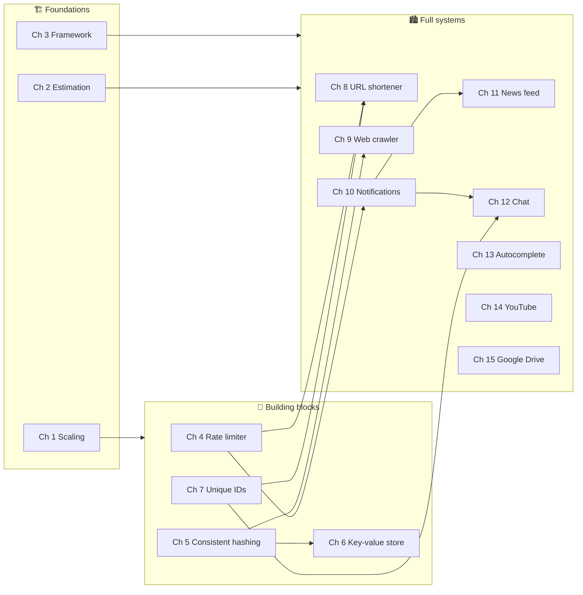
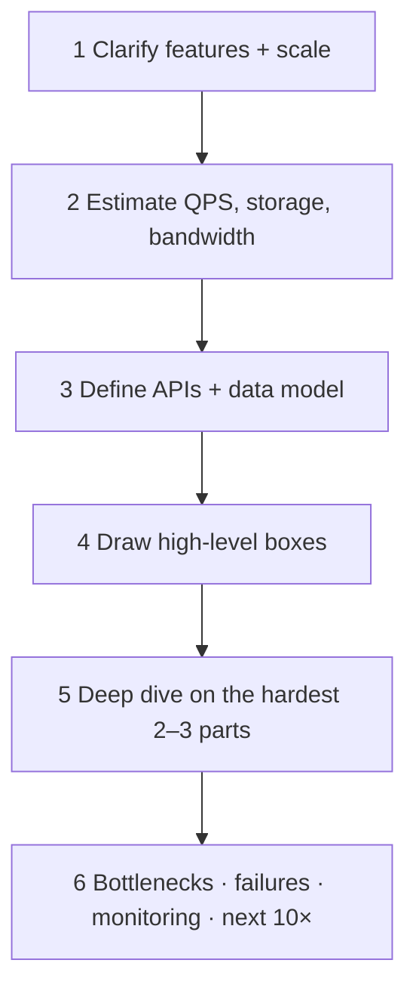

# Chapter 16 — The Learning Continues

> **In one line:** Designing good systems takes years of practice. The best next step is to study **how real companies built their real systems**, and to keep revisiting the building blocks from this book.
>
> The book's final chapter is a reading list of real-world architectures and company engineering blogs. This page is a study guide: how the chapters fit together, what to review, and where to keep learning.

---

## 1. How all 15 chapters fit together

### Which building block shows up where?
| Building block | Reused in |
|---|---|
| Load balancer, stateless web tier | Every chapter |
| Cache (Redis/Memcached) | Ch 1, 8, 11, 13, 15 |
| CDN | Ch 1, 11, 14 |
| Message queue | Ch 1, 10, 11, 12, 14, 15 |
| Consistent hashing | Ch 5, 6, 9, 11 |
| Unique ID generator | Ch 7, 8, 12 |
| Rate limiter | Ch 4, 8, 10, 11 |
| Sharding and replication | Ch 1, 6, 8, 11, 13, 15 |
| WebSocket / long polling | Ch 12 (WebSocket), Ch 15 (long polling) |
| Bloom filter | Ch 6, 8, 9 |
| Object / blob storage | Ch 14, 15 |

---

## 2. The universal design checklist ✅
Use this in every interview, whatever the problem:

**Questions to ask yourself at step 6:**
- Where is the **single point of failure**? Can I replicate it?
- What happens if this **cache / queue / DB** goes down?
- Is this path **read-heavy or write-heavy**? Where can a cache help?
- Do I need **strong** or **eventual** consistency here?
- What's the **hot key / celebrity** problem in this system?
- How do I **monitor** it (metrics, logs, alerts)?

---

## 3. Classic trade-offs to master
| Trade-off | Remember |
|---|---|
| SQL vs NoSQL | ACID and joins vs scale and flexible schema |
| Consistency vs availability (CAP) | Choose CP or AP during partitions |
| Push vs pull (fanout) | Fast reads vs cheap writes. Hybrid for celebrities. |
| Polling vs long polling vs WebSocket | Simplicity vs real-time, two-way |
| Cache TTL short vs long | Freshness vs DB load |
| 301 vs 302 | Lower load vs analytics |
| Replication vs sharding | Read scale and availability vs write and storage scale |
| Sync vs async (queue) | Simplicity vs decoupling and resilience |

---

## 4. Where to keep learning 📚
The book points readers to real-world case studies. Good general sources (search for them by name):

**Foundational papers** (short summaries are easy to find):
- **Google File System**, **MapReduce**, **Bigtable**: Google's storage and processing foundations.
- **Amazon Dynamo**: the model behind Chapter 6 (consistent hashing, quorum, vector clocks, gossip).
- **Cassandra**, **Kafka** and **ZooKeeper** papers: storage, logs and coordination.
- **Raft**: an understandable consensus algorithm.

**Engineering blogs** of large tech companies (Netflix, Uber, Airbnb, Meta, LinkedIn, Pinterest, Discord, Slack, Cloudflare, Stripe, Dropbox…) regularly explain how they scaled specific systems. Reading one post a week builds strong intuition.

**Next step after this book:** the advanced volume, covering proximity service, nearby friends, Google Maps, message queues, metrics monitoring, ad click aggregation, hotel reservation, email, object storage, leaderboards, payments, digital wallets and stock exchanges. Your notes for it are in the `advance system design` folder.

---

## 5. A 4-week revision plan 🗓️
| Week | Focus | Practice |
|---|---|---|
| 1 | Ch 1–3 (foundations) | Do 5 estimation problems. Explain the scaled architecture from memory. |
| 2 | Ch 4–7 (building blocks) | Implement a token bucket and a consistent-hash ring in code |
| 3 | Ch 8–11 | Mock-interview: URL shortener and news feed, 45 minutes each |
| 4 | Ch 12–15 | Mock-interview: chat and Google Drive. Review every self-check question. |

---

## 🧠 Final cheat sheet
- **Foundations:** stateless tiers, caching, CDN, replication, sharding, queues, monitoring.
- **Math:** 1 day ≈ 10⁵ s. Memory ≈ 100 ns. Disk seek ≈ 10 ms. Peak ≈ 2× average.
- **Process:** clarify → blueprint → deep dive → wrap up.
- **Mindset:** there's no perfect design, only **trade-offs explained clearly**.

---
[⬅️ Chapter 15 · Google Drive](15-Design-Google-Drive.md) | 🎉 **You finished Volume 1!** Continue with the advanced notes.
